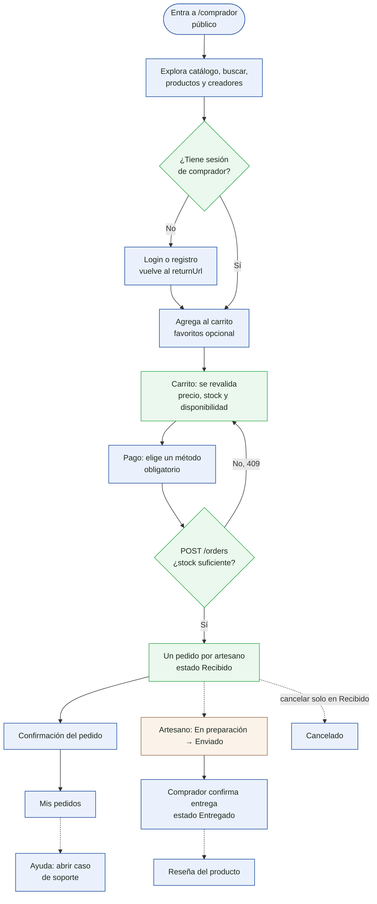
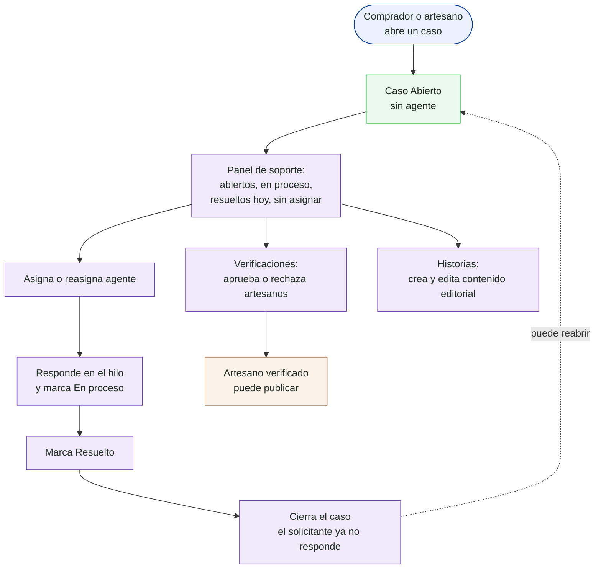

# Análisis para el plan de negocio de Makicol

> Documento de trabajo. Reúne el análisis que sustenta el plan de negocio de la propuesta:
> pagos y envíos, autenticación, estructura del plan y flujos por rol construidos desde el demo.
> El plan de trabajo completo está en la conversación de planificación; aquí se registra lo ya
> levantado y verificado. **Estado: Fase 0 completada; Fase 1 en curso (A1 y F2 a F5 en borrador, pendientes de contraste con el demo).**

**Equipo:** Jorge Luis Arévalo Murcia (estudiante de Análisis y Desarrollo de Software del SENA,
desarrollador full stack semi senior con más de 5 años de experiencia; desarrollo) y Rafael José
Granados Avendaño (tecnólogo en Guianza Turística egresado del SENA; producto, turismo y artesanos).

**Principio:** el demo es la evidencia de lo que existe hoy; la propuesta explica el plan para
producción. Cuando difieren, se dice de forma explícita ("en el demo es así; en producción será así").

## Índice

| Parte | Contenido | Estado |
|---|---|---|
| 1 | Pagos y envíos (O1 a O8) | pendiente |
| 2 | Autenticación y migración a un proveedor externo (A1 a A7) | **A1 en borrador** (§2) |
| 3 | Plan de negocio y depuración de la propuesta (B1 a B7) | pendiente |
| 4 | Flujos por rol desde el demo (F1 a F7) | **F1 a F5 en borrador** (§0 y §4); F6 y F7 pendientes |

## 0. Convenciones de los diagramas

- **Herramientas:** Mermaid para flujos y estados sencillos (se muestran directo en este documento);
  PlantUML (`plantuml.jar` + Graphviz, ya instalados) para secuencias y calles por rol, exportadas a SVG.
  Fuentes y SVG en `docs/diagramas/`.
- **Colores por rol:** comprador azul, artesano ocre, soporte violeta, auditor gris, sistema verde.
- **Estado de cada paso:** sólido = existe en el demo y está verificado; punteado = declarado pero
  no demostrado en ejecución (solo código, specs o pruebas); etiqueta **[prod]** = cambia en producción.
- **Tamaño:** máximo 12 a 15 nodos por diagrama; los largos se dividen.
- **Procedencia:** cada diagrama cita el código o la spec de donde sale. Nada se infiere sin fuente.
- **Demo en ejecución:** acceso de solo lectura con las cuentas demo. No se crean pedidos, casos ni
  usuarios en la API desplegada sin autorización expresa.

## 2. Autenticación (Parte 2)

### A1. Cómo funciona hoy la autenticación del demo

Diagrama: [`diagramas/a1-autenticacion-demo.puml`](diagramas/a1-autenticacion-demo.puml)
(SVG: [`diagramas/a1-autenticacion-demo.svg`](diagramas/a1-autenticacion-demo.svg)).

**Cómo funciona**

- **Emisión:** la API firma un JWT con clave simétrica (`HmacSha256`, `JwtSettings:Key`) con los
  claims id, correo, nombre y rol; dura **30 minutos**. El refresh token es aleatorio (48 bytes) y dura
  **7 días** (`AuthService.cs`, `AuthCommands.cs`).
- **Contraseñas:** BCrypt, mínimo 8 caracteres (`RegisterValidator`).
- **Registro público:** solo `buyer` y `artisan`; el artesano nace con verificación "Pendiente".
- **Renovación:** el refresh rota (revoca el usado y emite otro). Una sola renovación en vuelo,
  compartida entre peticiones (`AuthStore.refresh`, regla AUTH-001).
- **Sesión en el front:** `localStorage` clave `makicol.session` (regla AUTH-002).
- **Rutas:** `guestOnlyGuard`, `roleGuard`, `storefrontGuard` y `returnUrl` seguro (NAV-001 a NAV-007).
- **Protecciones existentes:** límite de intentos por IP en login y refresh (`auth-login`), registro de
  actividad de `login` y `login_failed`, validación de emisor, audiencia y vigencia del token.
- **Puerto de autenticación:** `AuthStore` depende de la interfaz `Authable` (`AUTH_REPOSITORY`) con
  `login`, `register`, `refresh` y `logout`; es la costura por donde entraría otro proveedor.

**Puntos débiles para producción (verificados en el código)**

| Punto | Hallazgo | Fuente |
|---|---|---|
| Token en `localStorage` | Cualquier script que corra en la página puede leerlo (riesgo XSS) | `auth.store.ts`, AUTH-002 |
| Clave de firma simétrica | La misma clave firma y valida; quien la tenga puede emitir tokens | `AuthService.cs`, `Program.cs` |
| Refresh token en claro en la BD | Se guarda el valor tal cual, no su hash | `AuthCommands.cs` |
| Sin detección de reutilización | Un refresh revocado solo devuelve 401; no revoca la cadena | `RefreshHandler` |
| Sin verificación de correo | El registro devuelve sesión sin confirmar el correo | `RegisterHandler` |
| Sin recuperación de contraseña | No encontré endpoint ni comando en el backend | búsqueda en `Makicol.*` |
| Sin MFA | No encontré soporte | búsqueda en `Makicol.*` |
| Sin bloqueo de cuenta | Solo hay límite por IP; no hay bloqueo por usuario | `LoginHandler` |
| Cuentas de backoffice | Soporte y auditor no se registran por la API pública; en el demo existen por el seed | `RegisterValidator`, `DemoDataSeeder.cs` |

> "No encontré" significa que no apareció en las búsquedas hechas el 26-oct-2026; se confirma al
> revisar el controlador completo antes de usarlo como afirmación en el plan de negocio.

**Contradicción con la propuesta (A2, adelanto):** el contrato de API de la propuesta dice
"autenticación propia" con JWT propio, y su diagrama de arquitectura muestra Azure AD B2C. Auth0 no
aparece en el sitio de la propuesta.

## 4. Flujos por rol (Parte 4)

### F2. Flujo del comprador (demo hoy)

Fuentes: `specs/frontend/routes-and-flows.md` (NAV-001 a NAV-007, CHK-001 a CHK-005),
`specs/features/002-revalidar-carrito` (CART-001 a CART-007), `libs/roles/buyer/*`,
`StatusSeeder.cs` (transiciones de pedido). Líneas punteadas = no demostrado en ejecución todavía.

**Qué muestra y por qué (ficha F7, borrador)**

- **Navegación pública:** el comprador explora sin cuenta (NAV-005); la sesión se pide solo al comprar.
  Reduce la fricción de entrada.
- **Revalidación del carrito:** precio y stock pueden cambiar mientras el comprador decide; el carrito
  se concilia y avisa en cada cambio (CART-003 a CART-005, CART-007). Protege de pagar un precio viejo.
- **Un pedido por artesano:** el comprador envía el carrito completo y el backend lo divide; cada
  artesano gestiona solo lo suyo.
- **El comprador cierra el ciclo:** la entrega la confirma él (transición Enviado → Entregado permitida
  al comprador), lo que habilita las reseñas.

**Lo que hoy NO hace el demo (se marca para la Parte 1 y el plan de negocio)**

- **No hay cobro:** el método de pago es una preferencia informativa, sin pasarela.
- **El método de pago no depende del artesano:** la lista es global y se envía un único valor para
  todo el carrito aunque haya varios artesanos (CHK-001).
- **Dirección y notas del checkout no se envían** (CHK-004, pendiente BR-7).
- **Tras recargar** la confirmación solo se encuentra entre los primeros 20 pedidos (CHK-005, BR-8).
- **Por verificar contra el demo:** pantalla de reseñas (aparece en el seed y en las reglas del
  backend; falta confirmar el flujo en el front) y los textos exactos del paso de pago.

### F3. Flujo del artesano (demo hoy)

Fuentes: `libs/roles/artisan/*` (rutas `panel`, `pedidos/:id`, `mis-productos`, `ayuda`, `mis-casos`),
`verification-banner.component.ts`, `artisan-order-detail-page.component.ts`, `StatusSeeder.cs`,
`RegisterHandler` (el artesano nace "Pendiente").

**Qué muestra y por qué (ficha F7, borrador)**

- **Verificación antes de vender:** no publica hasta que soporte lo apruebe; protege a los compradores y
  la reputación del catálogo. El banner decide el texto por `isTerminal` y `allowsPublishing`.
- **El artesano mueve el pedido, no cierra la venta:** avanza Recibido a En preparación y a Enviado; la
  entrega la confirma el comprador.
- **El demo lo dice con todas las letras:** la pantalla del pedido muestra "Preferencia de pago del
  comprador (…): el cobro se coordina fuera de la plataforma". Es el punto de partida de la Parte 1.
- **El panel** muestra pedidos en curso, entregados, ingresos y productos activos.

**A verificar:** el comentario del seed dice que la verificación "hoy es automática", pero el front tiene
una pantalla manual de soporte (filtro por defecto en Pendiente). El diagrama muestra la revisión manual,
que es lo que implementa el front.

### F4. Flujo de soporte (asesor) (demo hoy)

Fuentes: `libs/roles/support/*` (rutas `panel`, `casos`, `casos/:id`, `verificaciones`, `historias`),
`case-detail-page`, `artisan-verifications-page`, `StatusSeeder.cs` (transiciones de casos).

**Qué muestra y por qué (ficha F7, borrador)**

- **Un solo punto de ayuda** para compradores y artesanos, con prioridad, categoría y pedido relacionado.
- **Estados con roles:** solo soporte mueve el caso (Abierto, En proceso, Resuelto, Cerrado) y puede
  reabrir uno cerrado; las transiciones vienen del catálogo del backend.
- **Soporte también cuida el catálogo:** verifica artesanos y publica las historias del sitio.
- **Pendiente para el plan:** en la Parte 1 soporte pasaría a gestionar guías y estados de envío (simulado).

**Limitación conocida del backend:** se puede escribir en casos cerrados y la prioridad es texto libre
(BR-4); el front lo mitiga deshabilitando el envío en casos terminales.

### F5. Flujo del auditor (demo hoy)

Fuentes: `libs/roles/auditor/*` (rutas `resumen`, `ventas`, `artesanos`, `compradores`, `soporte`),
`summary-page.component.ts`, `routes-and-flows.md`.

**Qué muestra y por qué (ficha F7, borrador)**

- **Evidencia sin poder de cambio:** el auditor consulta, no modifica; da transparencia a aliados e
  inversionistas sobre ventas, artesanos, compradores y soporte.
- **El resumen** compara con el mes anterior (GMV, pedidos y casos) y acumula 12 meses.
- **Pendiente para el plan:** la comisión del 6% y la liberación de pagos (Parte 1) aparecerían aquí en
  producción; hoy el demo no calcula comisión.

## Acceso al demo en ejecución

**Causa del fallo inicial (26-oct-2026):** el DNS configurado en el equipo (el router, `192.168.40.1`)
rechaza el nombre de la API (`RCODE_REFUSED`); los DNS públicos (`8.8.8.8`, `1.1.1.1`) sí lo resuelven a
`20.118.48.17`. No es un problema de CORS ni de la API. El navegador funciona probablemente por DNS
seguro propio. Se sorteó sin cambiar la configuración del sistema, forzando la resolución con
`curl.exe --resolve`.

**Contraste hecho (solo lectura; login de la cuenta del comprador principal, sin crear nada):**

| Dato | Seed (`DemoDataSeeder.cs`) | Demo desplegado |
|---|---|---|
| Productos públicos | 8, con los nombres actuales del seed | **8, coinciden** (p. ej. "Sombrero vueltiao 21 vueltas" de Carmen Vidal) |
| Pedidos de la compradora principal | 6 | 6: Entregado 3, Enviado 1, Recibido 1, **Cancelado 1** |
| Casos de la compradora principal | 4, uno por estado | **4, uno por estado** (Abierto, En proceso, Resuelto, Cerrado) |

- **Cancelado:** el seed no crea pedidos Cancelados y el demo tiene uno de la compradora principal.
  Alguien canceló un pedido: **los datos publicados ya no son idénticos al seed**. Es evidencia en
  ejecución de que el comprador puede cancelar un pedido Recibido (F2).
- **Artesanos:** los productos confirman la versión actual del seed (Carmen Vidal con sombrero vueltiao)
  y no la antigua (barniz de Pasto); el perfil de Luis (Mompox, filigrana) lo confirma la segunda ronda.
- La llamada incluyó un login (queda un refresh token y una entrada `login` en el registro de
  actividad); no se creó ni se cambió ningún dato.

**Contraste por rol (segunda ronda, solo lectura, un login por cuenta):**

| Rol | Dato observado en el demo | Lectura |
|---|---|---|
| Artesano Luis Castillo | Verificación **Pendiente**, Mompox, filigrana de plata, pago `nequi` | Coincide con el seed actual; la verificación no se aprobó sola |
| Artesana Rosa Noriega | Verificada, Riohacha, tejido wayuu, pago `nequi`; 3 pedidos: Entregado 2, En preparación 1 | Coincide; el panel del artesano muestra sus pedidos |
| Soporte Sofía Ramírez | 4 casos: Abierto, En proceso, Resuelto, Cerrado; **los 4 son de compradores**, ninguno de artesanos | Coincide con el seed |
| Auditor Aurora Benítez | Métricas con datos solo en sep-2026 (GMV 320.000, 4 entregados) y oct-2026 (GMV 200.000, 2 entregados, 4 casos); los demás meses en cero | El resumen y las gráficas tienen datos reales del demo |

- **Verificación de artesanos (F3):** Luis sigue Pendiente en el demo, lo que apoya la revisión manual
  por soporte. Falta ver el alta de un artesano nuevo para descartar una aprobación automática.
- **Datos de pago:** todos los artesanos y pedidos consultados usan `nequi`: el demo no permite probar
  hoy la elección de medios por artesano (Parte 1).
- **Sin contrastar todavía:** flujo de reseñas en pantalla y el listado de verificaciones del soporte:
  la consulta del endpoint con `statusId` devolvió los 4 artesanos tanto para Pendiente como para
  Verificado, así que ese parámetro no filtró (el front puede usar otro nombre; sin confirmar).
- **Existe en la API (swagger):** `POST /products/{id}/reviews` (reseñas) y
  `PATCH /artisans/{userId}/verification` (verificación). **No existen** endpoints de pagos, de comisiones
  ni para crear o actualizar envíos internacionales; solo el catálogo de estados. Es la brecha de la Parte 1.
- **Límite de intentos medido:** ocho inicios de sesión en pocos segundos activaron el límite
  (`auth-login`, mensaje "Demasiados intentos"); tras esperar cerca de un minuto volvió a responder.
  Es un dato real para A1. Los inicios de sesión del contraste quedan en el registro de actividad del
  demo (visibles para el auditor), junto con los de las cuentas usadas.

**Aún por contrastar:** flujo de reseñas, alta de un artesano nuevo y las pantallas (no solo los datos).

## Pendientes inmediatos

1. Contrastar las pantallas del demo (reseñas, alta de artesano, listado de verificaciones) con una
   revisión visual tuya o capturas.
2. Completar A1 con la revisión del controlador completo y los límites de intentos configurados.
3. Flujos de extremo a extremo (F6) y fichas F7 completas.
4. Inventario de la propuesta (B2, B2b, B3, B4) y recolección de cifras para la auditoría B2b.
