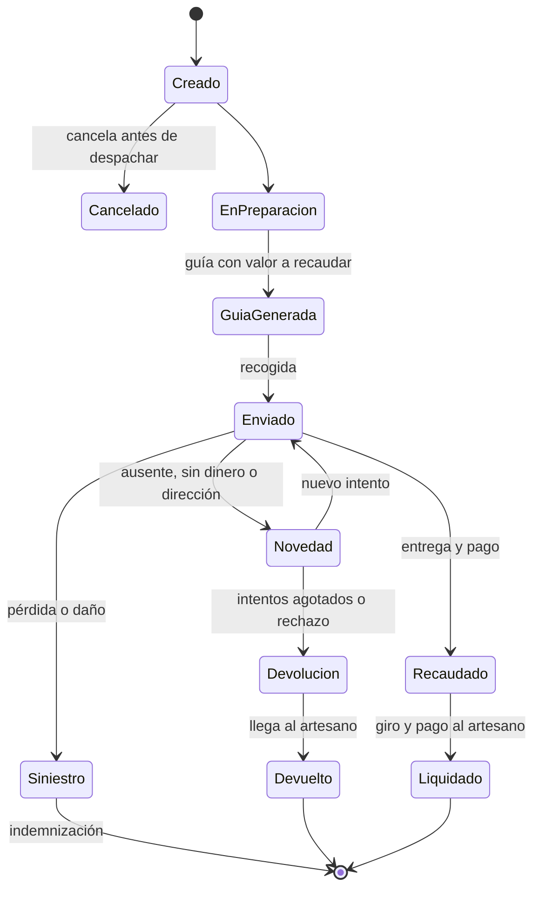
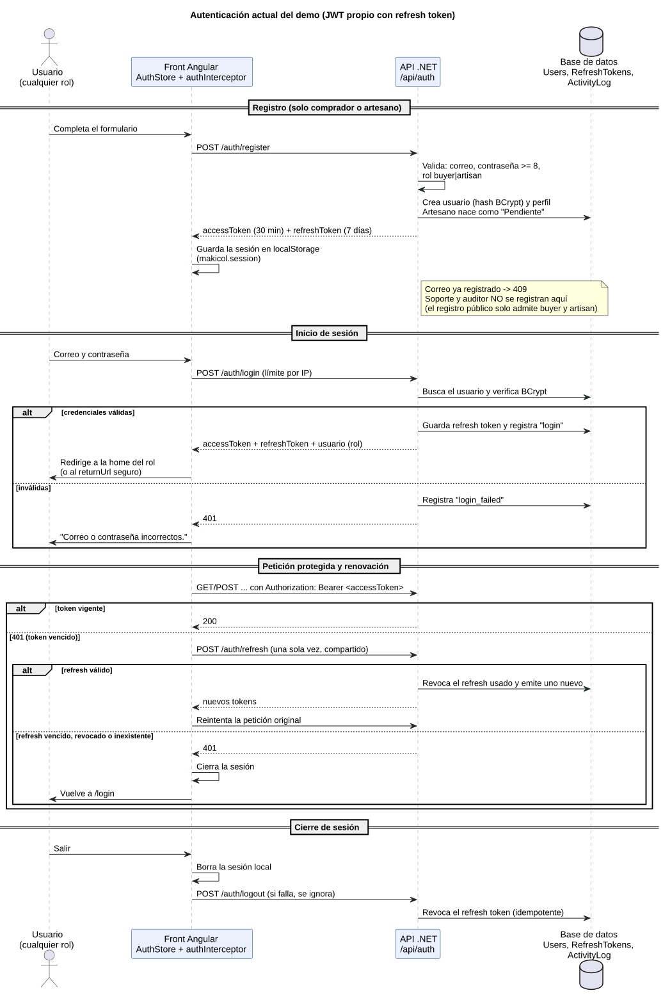
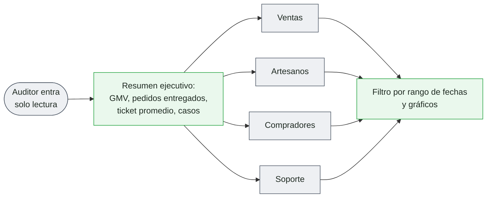
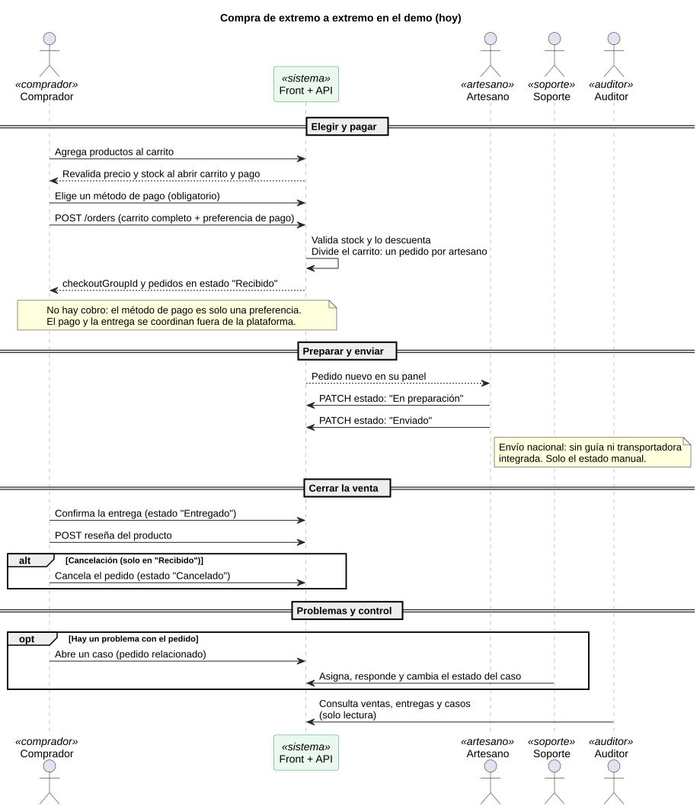
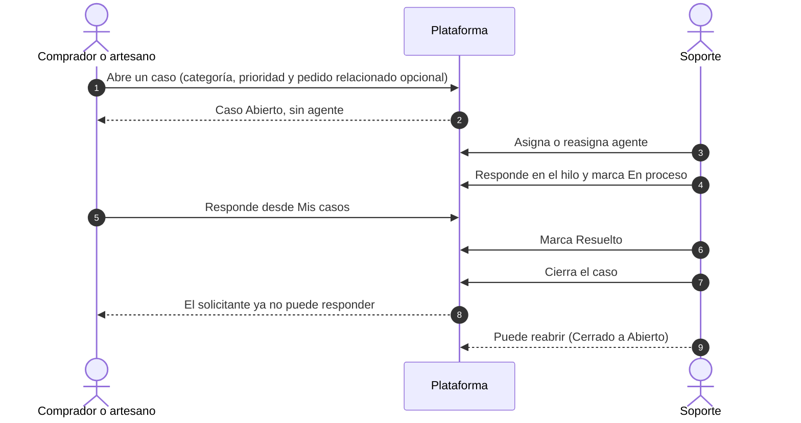
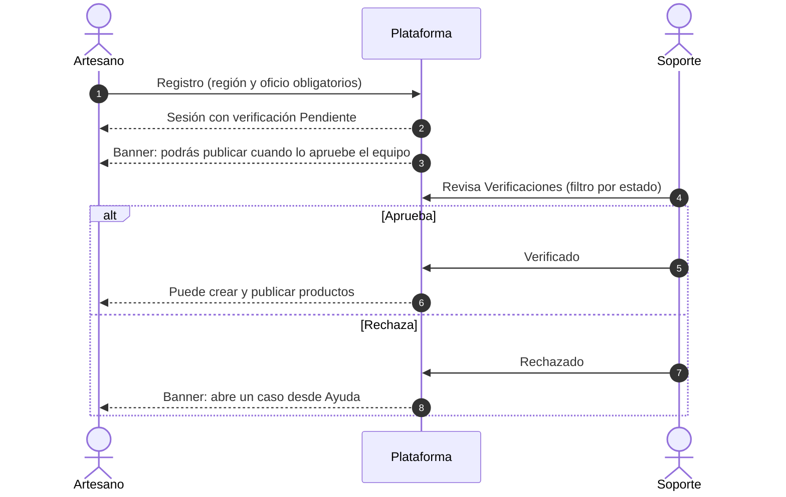
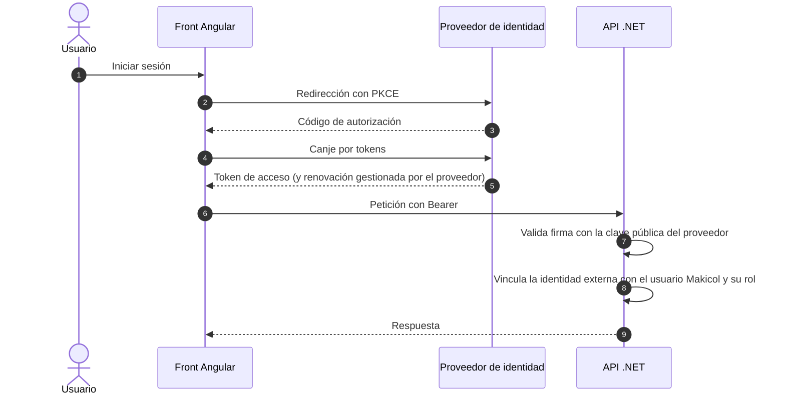
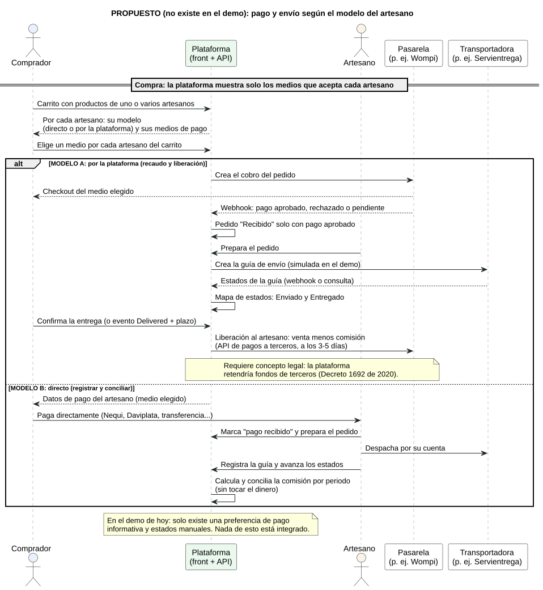
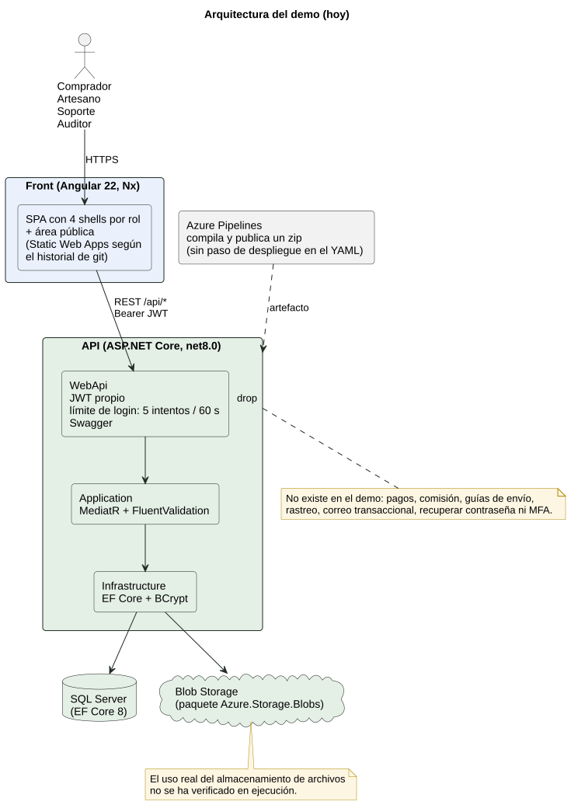
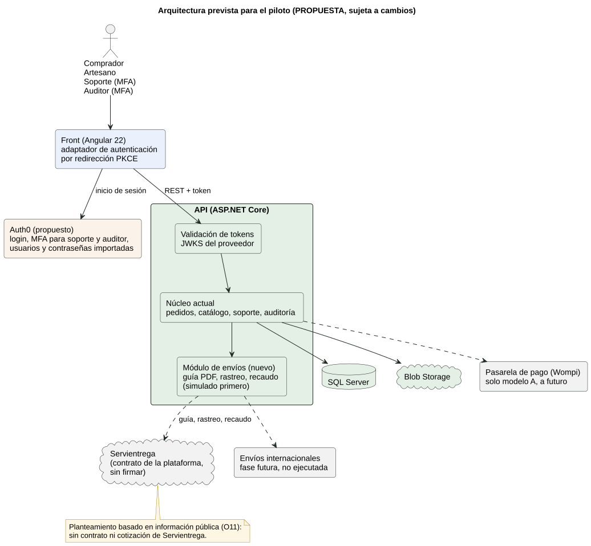

# Análisis para el plan de negocio de Makicol

> Documento de trabajo. Reúne el análisis que sustenta el plan de negocio de la propuesta:
> pagos y envíos, autenticación, estructura del plan y flujos por rol construidos desde el demo.
> El plan de trabajo completo está en la conversación de planificación; aquí se registra lo ya
> levantado y verificado. **Estado: Fase 0 completada; Fase 1 en curso (A1 y F2 a F5 en borrador, pendientes de contraste con el demo).**

**Equipo:** Jorge Luis Arévalo Murcia (estudiante de Análisis y Desarrollo de Software del SENA,
desarrollador full stack semi senior con más de 5 años de experiencia; desarrollo) y Rafael José
Granados Avendaño (tecnólogo en Guianza Turística egresado del SENA; producto, turismo y artesanos).

**Principio:** el demo es la evidencia de lo que existe hoy; la propuesta explica el plan para
producción. Cuando difieren, se dice de forma explícita ("en el demo es así; en producción será así").

## Índice

| Parte | Contenido | Estado |
|---|---|---|
| 1 | Pagos y envíos (O1 a O8) | **Borrador completo** (§1); decisiones en O8 |
| 2 | Autenticación y migración a un proveedor externo (A1 a A7) | **Borrador completo** (§2); decisiones en A7 |
| 3 | Plan de negocio y depuración de la propuesta (B1 a B7) | **Inventario y diagramas de arquitectura B5** (§3); faltan B1, B5b y revisiones sin verificar; sin cambios en la propuesta |
| 4 | Flujos por rol desde el demo (F1 a F7) | **F1 a F7 en borrador** (§0 y §4); falta contrastar pantallas y revisión visual |

## 0. Convenciones de los diagramas

- **Herramientas:** Mermaid para flujos y estados sencillos (se muestran directo en este documento);
  PlantUML (`plantuml.jar` + Graphviz, ya instalados) para secuencias y calles por rol, exportadas a SVG.
  Fuentes y SVG en `docs/diagramas/`.
- **Colores por rol:** comprador azul, artesano ocre, soporte violeta, auditor gris, sistema verde.
- **Estado de cada paso:** sólido = existe en el demo y está verificado; punteado = declarado pero
  no demostrado en ejecución (solo código, specs o pruebas); etiqueta **[prod]** = cambia en producción.
- **Tamaño:** máximo 12 a 15 nodos por diagrama; los largos se dividen.
- **Procedencia:** cada diagrama cita el código o la spec de donde sale. Nada se infiere sin fuente.
- **Demo en ejecución:** acceso de solo lectura con las cuentas demo. No se crean pedidos, casos ni
  usuarios en la API desplegada sin autorización expresa.

## 1. Pagos y envíos (Parte 1)

Borrador de trabajo. Lo verificado en código o con fuente va sin marca; lo que es **análisis propio** o
**propuesta** se indica. Nada de lo propuesto está implementado; cualquier cambio en el front sigue el proceso
spec driven y cualquier cambio en el backend requiere tu autorización por separado.

### O1. Cómo funciona hoy (demo)

Ver F2, F3 y F6a. En resumen: el comprador elige **un** método de pago de una lista global (`nequi`,
`daviplata`, `bancolombia`, `efectivo`); el front envía el carrito con **una sola** preferencia de pago; el
backend crea **un pedido por artesano**; el pedido muestra "el cobro se coordina fuera de la plataforma"; el
artesano avanza los estados a mano y el comprador confirma la entrega. No hay cobro, comisión, guía de envío
ni integración con transportadoras (no existen esos endpoints en el Swagger).

### O2. Propuesta frente al demo

| Tema | La propuesta dice | El demo hace |
|---|---|---|
| Cobro | Pagos online con Wompi desde la Fase 1 | Sin cobro; preferencia informativa |
| Comisión | 5-8 % (financiero) y 6 % (prototipo) | No se calcula ni se muestra |
| Liberación del pago | 3 a 5 días tras confirmar la entrega (FAQ del prototipo) | No existe |
| Medio de pago del artesano | Elige cómo cobrar al registrarse (prototipo) | El perfil guarda **un** `paymentMethod`; el checkout lo ignora |
| Envío nacional | Estado del envío en el panel del productor | Estados manuales, sin guía |
| Envío internacional | Flujo de seis etapas con courier | Solo el catálogo de estados y un DTO de solo lectura; sin creación |

### O3. Dos modelos de cobro (y uno mixto)

- **Modelo A, por la plataforma:** la plataforma cobra, retiene y libera al artesano tras la entrega,
  descontando su comisión.
- **Modelo B, directo:** el comprador paga al artesano; la plataforma registra el pedido y su estado, **sin
  comisión y sin tocar el dinero**.

| Criterio | Modelo A (por la plataforma) | Modelo B (directo) |
|---|---|---|
| Flujo del dinero | Comprador a plataforma a artesano | Comprador a artesano |
| Comisión | Se descuenta sola al liberar el pago | **Ninguna** (decidido por el usuario): en B la plataforma no cobra comisión al artesano ni al comprador |
| Costo de pasarela | 2,65 % + COP 700 + IVA por pago (Wompi), unos 3,7 % de una venta de USD 50 | Ninguno para la plataforma |
| Ingreso para la plataforma | Comisión del 6 % menos la pasarela: ~2,3 % de la venta (ver 3.6) | **Ninguno por venta**; B funciona como canal de captación y no como fuente de ingresos |
| Disputas y devoluciones | La plataforma puede retener y mediar (soporte tendría herramientas) | Solo conversación entre las partes; soporte media sin poder |
| Confianza del comprador | Alta: paga a la plataforma y recibe protección | Menor: paga directamente a un tercero sin intermediario (análisis propio) |
| Regulación en Colombia | **Requiere concepto legal**: retener fondos de terceros se acerca a actividades reguladas (Decreto 1692 de 2020; concepto del Banco de la República) | Bajo riesgo: no toca dinero de terceros |
| Operación técnica | Integrar pasarela, webhooks, conciliación y pagos a terceros (Wompi ofrece una API de dispersión) | Registrar pedido, medio de pago y estado como información; sin integración obligatoria |
| Carga para el artesano | Menor: no gestiona cobro; ve su saldo | Mayor: cobra y concilia por su cuenta |
| Encaje con roles | Soporte y auditor verían pagos y liberaciones | Auditor vería solo pedidos y estados (no hay comisión que auditar) |

**Decisiones del usuario (26-oct-2026):**

1. El artesano elige el modelo **por artesano**, no por producto.
2. **Se empieza por el modelo B** (directo).
3. En el modelo B **no hay comisión** de la plataforma, ni para el artesano ni para el comprador.
4. **La primera financiación es el patrocinio**, con o sin comisión; las demás fuentes (comisión en A,
   suscripción, destacados, cargos) son posibilidades de ingreso, no el plan base.
5. En el modelo B **el estado de la compra lo manejan el comprador y el artesano entre sí**; la plataforma
   lo registra, no lo decide ni lo automatiza.
6. **La simulación vive en el backend.**
7. **El piloto usa Servientrega.**
8. **No hay abogado consultor todavía**, pero se reconoce que hace falta y que su participación y costo deben
   contemplarse (O10).
9. **El contrato con Servientrega lo hace la plataforma** en el piloto, para generar los comprobantes de envío
   (guías) y seguir el rastreo; como mínimo en el plan en que la plataforma controla la compra (ver O11).
10. Un pedido contra entrega **cuenta como venta cerrada cuando se realiza el recaudo** (ver O12).
11. **La migración de autenticación se hace antes del piloto**, y **el MFA es obligatorio para soporte y
    auditor** (ver A8).

**Recomendación preliminar sobre lo que sigue (análisis propio, sujeta a concepto legal):**

1. **Diseñar A desde ya**, con un concepto legal en marcha, para activarlo cuando esté resuelto.
2. **Ingresos:** el plan base es el **patrocinio** (decisión del usuario). Como posibilidades, no compromisos:
   comisión en A (donde la pasarela consume ~60 % del 6 %, con opciones como comisión mayor, trasladar el
   costo de la pasarela al comprador o un cargo fijo por pedido), suscripción o destacados para artesanos.
3. **Cambiar el relato del plan de negocio**: la comisión del 6 % "por venta completada" deja de ser universal.

### O3b. El artesano elige su modelo

| Nivel de la elección | Ventajas | Problemas |
|---|---|---|
| **Por artesano** (recomendado) | Una decisión en su perfil; coincide con "un pedido por artesano"; el carrito, la comisión y los estados siguen siendo por artesano | Un artesano no puede mezclar modelos |
| Por producto | Máxima flexibilidad | Un pedido tendría líneas con modelos distintos; obliga a dividir pedidos por modelo, a duplicar estados de pago y a explicar comisiones mixtas |

Recomendación: **por artesano**. Regla de transición a definir: cambiar de modelo afecta solo a pedidos nuevos;
los pedidos en curso conservan el modelo con el que se crearon. Un artesano sin medios de pago configurados no
debe poder publicar en el modelo elegido.

Datos que faltan hoy (candidatos a `BR`, sin autorizar): un campo de **modelo** (`direct` o `platform`) y una
lista de **medios aceptados** por artesano (hoy solo hay un `paymentMethod`).

### O3c. El checkout respeta lo que acepta cada artesano

Reglas candidatas (IDs provisionales; se convierten en spec cuando se decida implementarlas):

| ID | Regla propuesta |
|---|---|
| PAY-001 | El checkout agrupa el carrito por artesano y muestra, por cada grupo, **solo los medios que ese artesano acepta** |
| PAY-002 | Cada grupo exige elegir un medio de pago antes de confirmar |
| PAY-003 | Cada grupo muestra el modelo del artesano (directo o por la plataforma) y qué significa para el pago y el envío |
| PAY-004 | Un artesano sin medios aceptados no puede vender; sus productos no se pueden comprar |
| PAY-005 | El pedido guarda el medio elegido **por pedido** (no uno solo para todo el carrito) |

Hoy: la lista es global y se envía un solo valor (`CHK-001`), y el perfil del artesano guarda un solo
`paymentMethod`. Cambia el contrato de `POST /orders` (una preferencia por artesano) y el de perfil de
artesano: ambos son cambios de backend a proponer como BR.

### O3d. Efectivo: contra entrega por transportadora (decidido)

Decisión del usuario: en el modelo B el efectivo se maneja como **pago contra entrega con las opciones que ofrecen
Servientrega u otras transportadoras colombianas**, y no como un pago que la plataforma procese.

| Dato | Resultado | Fuente |
|---|---|---|
| Servientrega, "Contraentrega E-Commerce" | Para personas naturales y micropymes: la empresa **recauda el valor del producto al entregar** y lo consigna en la cuenta que indique el cliente; el flete se paga en el centro de soluciones remitente | servientrega.com |
| Condiciones del servicio | Se presta **entre ciudades capitales o cabeceras de regional**, en centros de soluciones autorizados; el pago puede ser en efectivo o con datáfono. Si el destinatario no reclama el envío, vuelve al origen y el remitente paga **doble flete** | servientrega.com, preguntas frecuentes |
| Comisión por recaudo | Según una guía de terceros (no oficial, sin verificar con cada empresa): Servientrega 4 % con mínimo de COP 3.500, Interrapidísimo 5 %, Envía entre 2,4 % y 3,5 %, Coordinadora no la publica | rastreoguias.com.co (secundaria) |
| Otras transportadoras | Interrapidísimo ("Pago en Casa"), Coordinadora (incluye recaudo anticipado por enlace) y Envía también ofrecen recaudo | sitios de cada empresa y guías de terceros |

Lo que implica (análisis propio):

- La **comisión del recaudo la cobra la transportadora al artesano**, no la plataforma; encaja con "B sin
  comisión".
- El artesano necesita **su propio contrato o cuenta** con la transportadora; la plataforma no lo gestiona.
- **Riesgo principal:** rechazo o ausencia del comprador (el paquete vuelve y se paga el flete de regreso). Debe
  verse en el pedido como novedad, no como entrega.
- **Límite de cobertura:** al prestarse entre capitales y cabeceras de regional, algunos destinos de artesanos
  (por ejemplo Uribia o Mompox) pueden no tener el servicio; el artesano debe confirmarlo con su transportadora.
- La plataforma debe mostrar al comprador desde el checkout el total que pagará en la puerta (producto más
  flete), para evitar rechazos.

Reglas candidatas adicionales (IDs provisionales):

| ID | Regla propuesta |
|---|---|
| PAY-006 | `contraentrega` es un medio de pago que el artesano puede activar en el modelo B, junto con transferencias y billeteras |
| PAY-007 | El checkout muestra el total a pagar en la puerta y quién asume flete y comisión de recaudo, antes de confirmar |
| PAY-008 | Un pedido contra entrega **cuenta como venta cerrada cuando la transportadora registra el recaudo**; mientras tanto es un pedido en curso, y una novedad o devolución nunca lo cierra (decidido; ver O12) |

### O4. Qué información de envío se recibe y cómo

Ver 3.6. En resumen: Servientrega publica una API (con webhooks y creación de guías) cuyas credenciales entrega
la empresa a clientes con contrato; también existe el rastreo SOAP `EstadoGuias` (requiere ID de cliente) y
agregadores como AfterShip que normalizan estados. **Para recibir estados reales hace falta un contrato o un
agregador**; para el demo basta con simularlos.

### O5. Mapa de estados de envío a estados del pedido (propuesto)

Estados normalizados de un agregador (AfterShip) frente a los estados del pedido del demo:

| Estado de la transportadora | Efecto propuesto en el pedido | Observación |
|---|---|---|
| `Pending`, `InfoReceived` | Sin cambio (guía creada) | El pedido sigue En preparación |
| `InTransit`, `OutForDelivery` | **Enviado** | Hoy lo marca el artesano a mano |
| `Delivered` | Habilita **Entregado** | Decisión: lo confirma el comprador (como hoy) o se confirma solo tras N días |
| `AttemptFail`, `Exception`, `Expired`, `AvailableForPickup` | **Novedad**: alerta a soporte | **No existe** un estado de novedad ni de devolución en el pedido; habría que crearlo (cambio de backend) |

**Aplicación según el modelo:** en el modelo B (el de arranque) el estado del pedido lo manejan el comprador y
el artesano; los eventos de Servientrega son **informativos** (número de guía y seguimiento visibles) y no
cambian el estado por sí solos. La traducción automática de la tabla queda como opción para el modelo A.

En el modelo A, la **liberación del pago** se dispara con el pedido en **Entregado** (más el plazo de 3 a 5 días
que ya anuncia la propuesta). El front sigue comparando estados por `id` o `isTerminal`, no por nombre.

### O6. Proceso simulado para el demo (propuesto)

Objetivo: mostrar el flujo completo sin integrar nada real. La lista siguiente es el **catálogo completo**
(modelos A y B); el alcance de arranque, solo modelo B, está más abajo.

1. **Pasarela simulada** con tres resultados (aprobado, rechazado, pendiente) para el modelo A.
2. **Guía simulada** al marcar un pedido como enviado (número de guía y transportadora ficticios).
3. **Avance de estados** por un "simulador" (acción de soporte o temporizador) que reproduce los estados
   normalizados de O5, incluida una novedad.
4. **Comisión y desglose** visibles para el comprador, el artesano y el auditor.
5. **Liberación simulada** del pago al marcar el pedido como entregado.

Dónde vive la simulación (decidido):

| Opción | Ventaja | Inconveniente |
|---|---|---|
| **A. En el front**, con adaptadores simulados detrás de interfaces (como el puerto de autenticación) | No toca el backend; se puede hacer ya | Los datos no se comparten entre usuarios ni sobreviven al navegador; el auditor no vería nada |
| **B. En el backend**, con endpoints simulados | Datos reales entre roles y el auditor los ve | Requiere autorizar cambios y despliegue del backend |

**Decisión del usuario: la simulación vive en el backend** (opción B de la tabla). Así los cuatro roles ven los
mismos datos y el auditor puede consultarlos. Alcance para el arranque (modelo B):

1. Guía simulada de **Servientrega** (número y estados informativos) al registrar el envío.
2. Pago contra entrega simulado: recaudo pendiente, recaudado o rechazado por el comprador.
3. Estados del pedido movidos por comprador y artesano, como en producción; el simulador solo aporta los
   eventos informativos de la guía.
4. La pasarela, la comisión y la liberación del pago (modelo A) **no se simulan por ahora**.

Casos límite a cubrir: comprador ausente o que rechaza el paquete, devolución y disputa con soporte.

**Condición:** es un cambio de backend. Antes de tocarlo hace falta una `BR` por cada cambio y tu autorización
para editar, compilar y desplegar, que valen por separado. El front se adaptaría cuando el contrato exista.

### O7. Impacto (inventario, sin implementar)

| Área | Cambio | Autorización |
|---|---|---|
| Backend | Modelo y medios aceptados por artesano; preferencia de pago por pedido; estado de pago; estados de novedad y devolución; endpoints de pago y guía (simulados o reales); cálculo de comisión **solo para el modelo A** | BR por cambio, y editar, compilar y desplegar por separado |
| Front | Perfil del artesano (modelo y medios), checkout por grupo, detalle del pedido con pago y guía, vista del auditor con comisión (solo modelo A) | Feature con spec, plan y tareas |
| Propuesta | Modelo de ingresos, costos de Azure sin servicios retirados, sección de pagos y envíos con las dos opciones | Con tu aprobación |
| Legal | Concepto sobre recaudo para terceros y términos y política de comisiones | Tu decisión; los textos legales son puntos pendientes |

### O8. Decisiones que te tocan

1. ~~¿Por artesano o por producto?~~ **Resuelto: por artesano.**
2. ~~¿Empezamos por B?~~ **Resuelto: se empieza por B, sin comisión.**
3. ~~¿Qué hacer con el efectivo?~~ **Resuelto: contra entrega por transportadora en el modelo B (ver O3d).**
4. ~~¿Cómo se financia la plataforma?~~ **Resuelto: patrocinio primero; el resto son posibilidades.**
5. ~~¿Dónde vive la simulación?~~ **Resuelto: en el backend** (requiere BR y autorización).
6. ~~¿Quién confirma la entrega?~~ **Resuelto en B: comprador y artesano entre sí**, sin automatismo.
7. ~~¿Transportadora del piloto?~~ **Resuelto: Servientrega, contratada por la plataforma.** Sin contrato todavía: falta cotizar y confirmar con Servientrega lo que permite (O11).
8. ~~¿Quién consulta al abogado?~~ **Resuelto en principio:** hace falta un abogado y se presupuesta (O10). Falta elegir quién y cuándo.
9. ~~¿Cuándo es venta cerrada un pedido contra entrega?~~ **Resuelto: al realizarse el recaudo.** Falta decidir los casos de O12 que aún están abiertos.

### O9. Envíos fuera del país: posibles, **no ejecutados**

Decisión del usuario: los envíos internacionales se plantean **como posibilidad futura**, con un esquema básico
de funcionamiento, y se aclara que **hoy no se ejecutan**. Esto aplica a todo el sitio: la sección de la
propuesta debe llevar un rótulo visible de "fase futura, no ejecutada".

**Qué existe hoy:** solo el catálogo de cinco estados (Preparación, Trámites de exportación, En tránsito,
Aduana EE. UU., Entregado) y un DTO de solo lectura con `courier`, `trackingNumber` y la referencia del
certificado de origen. **No hay endpoints ni pantallas para crear o avanzar un envío internacional.**

**Cómo podría funcionar (esquema básico, ya revisado frente a fuentes):**

| Etapa | Qué pasa | Estado de la verificación |
|---|---|---|
| 1. Pedido internacional | El comprador en EE. UU. ve precio, plazo estimado y paga en línea | Pago internacional: pendiente de diseño (Wompi acepta tarjetas internacionales sin costo adicional) |
| 2. Preparación | El artesano produce, empaca y emite la factura comercial | Del flujo de la propuesta |
| 3. Trámites de exportación | RUT con actividad de exportador, declaración de exportación y **prueba de origen** | La DIAN indica autocertificación para el acuerdo con EE. UU.; el resto, por verificar |
| 4. Envío internacional | Courier (DHL, FedEx) o correo postal | Tarifas sin verificar |
| 5. Aduana de EE. UU. | Desde el 29-ago-2025 ya no hay exención de "de minimis"; por courier se exige entrada ante CBP y por correo postal se pagan aranceles según la tasa IEEPA | Verificado con CBP |
| 6. Entrega | Última milla dentro de EE. UU. | Del flujo de la propuesta |

**Restricciones de producto:** algunos materiales exigen permisos (por ejemplo las semillas del "Collar de
semillas Wayúu", riesgo alto por APHIS); el piloto se limitaría a productos de riesgo bajo o medio.

**Condiciones para activarlo (todas pendientes):** decisión comercial, concepto aduanero y legal, contrato con un
courier con gestión aduanera, cotizaciones vigentes, flujo de pago internacional y, en el demo, estados y
pantallas que hoy no existen. Hasta entonces, no se ofrece en la plataforma ni se simula.

### O10. Asesoría legal: qué se necesita y qué costo prever

Hoy **no hay abogado consultor**. Se deja constancia de que hace falta y de que su participación y costo deben
entrar en el plan (análisis propio sobre los puntos que ya aparecen en este documento):

| Tema | Cuándo se necesita | Origen |
|---|---|---|
| Términos y condiciones y política de tratamiento de datos | **Antes de un piloto con usuarios reales**, incluso en el modelo B | Punto `pendiente` de los términos de uso del front |
| Responsabilidades de la plataforma en un modelo directo (disputas, devoluciones, reclamos de consumidores) | Antes del piloto | Modelo B |
| Concepto sobre recaudo y liberación de fondos de terceros | Antes de activar el modelo A | Decreto 1692 de 2020 y concepto del Banco de la República (3.6) |
| Acuerdos con artesanos y con patrocinadores | Al firmar | Patrocinio como primera fuente de financiación |
| Exportación y aduanas | Solo si se activan los envíos internacionales (O9) | Concepto aduanero |

**Costo:** no hay cifra verificada. Se propone pedir cotización a dos o tres firmas o abogados independientes por
concepto cerrado (no por horas abiertas) y reflejar el monto como rubro de costos del plan de negocio. Hasta
recibirlas, el rubro queda como **"por cotizar"**, sin inventar un número.

### O11. Servientrega para el piloto: planteamiento (sujeto a cambios)

> **Aclaración:** todo lo de esta sección es un planteamiento **basado en información disponible en línea** (consulta
> del 26-oct-2026). **No hay contrato ni cotización de Servientrega** y las condiciones pueden cambiar o
> variar al negociar. Se confirma con un asesor comercial antes de comprometer nada.

**Decisión del usuario:** la plataforma contrata con Servientrega para poder generar los comprobantes de envío
(guías) y seguir el rastreo de los pedidos, **al menos en el plan de pago en el que la plataforma controla la
compra** (interpreto que es el modelo A; en el modelo B el uso queda como opción por decidir).

**Lo que muestra la información pública:**

| Capacidad | Información encontrada | Fuente y reserva |
|---|---|---|
| Contraentrega para micropymes | "Contraentrega E-Commerce": recauda al entregar y consigna en la cuenta certificada; el flete se paga en origen. Existe un portal propio de contraentrega e-commerce | servientrega.com |
| Pago al recibir | Efectivo o datáfono según la zona | servientrega.com; un intermediario dice **solo efectivo** (contradicción por verificar) |
| Crédito | "Credicontado": crédito por 15 días calendario | portal de contraentrega e-commerce |
| Generar guía e imprimir | Web service `GeneracionGuias.asmx` con `GenerarGuiaStickerTiendasVirtuales` (genera el adhesivo de la guía y lo envía por correo) y datos de recaudo | web.servientrega.com (documentación técnica; requiere usuario, clave y código de facturación del contrato) |
| API de integración y webhooks | Documentación pública con Swagger, integraciones para Shopify y WooCommerce y un campo `valor_recaudar`; las claves las entrega Servientrega | servientregaapi.com. **Los ejemplos usan ciudades de Panamá:** hay que confirmar que aplica a Colombia |
| Rastreo | Estados de guía por servicio web (ver 3.6) o por agregadores como AfterShip | Requiere ID de cliente |
| Cobertura de contraentrega | Entre ciudades capitales o cabeceras de regional, en centros autorizados | servientrega.com, preguntas frecuentes |
| Devolución por no reclamar | Servientrega indica **doble flete** para el remitente en la modalidad de reclamo en oficina; un intermediario dice que la devolución tras 2 o 3 intentos no tiene costo | Información contradictoria; confirmar |
| Recaudo a través de un intermediario | mipaquete.com publica 4,3 % y 5,5 % del valor recaudado con mínimo COP 5.000, pagos los jueves y costos de transferencia (COP 2.000 a 8.500) | Resumen de búsqueda (**no pude abrir la página**); dos porcentajes distintos sin explicar; verificar |

**Caminos posibles para el piloto (análisis propio):**

| Camino | Ventaja | Inconveniente |
|---|---|---|
| 1. Contrato directo (cliente crédito o contraentrega e-commerce) con acceso a la integración | Control total de guías, rastreo y recaudo; tarifa negociable | Requiere visita comercial, contrato y posibles mínimos; plazo incierto |
| 2. A través de un agregador (por ejemplo mipaquete o Envía) con transportadora Servientrega | Sin contrato propio; rápido de empezar; guía y rastreo ya resueltos | Costo por recaudo más alto; dependencia de un tercero; el dinero pasa por él |
| 3. Cada artesano contrata por su cuenta | La plataforma no maneja dinero ni contrato | Contradice la decisión; sin comprobantes ni rastreo propios |

Propuesta de trabajo: **solicitar cotización a Servientrega (camino 1) y, en paralelo, evaluar un agregador
(camino 2) como plan de respaldo**, y simular las guías y el rastreo en el backend mientras tanto (O6).

**Flujo propuesto con contrato de la plataforma:**

1. El pedido contra entrega queda confirmado; la plataforma conoce el valor a recaudar (producto y flete).
2. La plataforma **genera la guía** con el recaudo y entrega al artesano el **comprobante en PDF** para imprimir.
3. El artesano empaca y entrega el paquete o programa la recolección.
4. La plataforma **sigue el rastreo** y lo muestra a comprador, artesano, soporte y auditor.
5. Servientrega entrega y cobra; el recaudo queda registrado (**venta cerrada**, O12).
6. Servientrega gira el recaudo a la cuenta de la plataforma y esta lo liquida al artesano.

**Preguntas para el asesor de Servientrega:** acceso a la API para un cliente de nuestro tamaño; formato de la
guía (adhesivo o carta); webhooks o consulta del rastreo; comisión por recaudo y mínimo; calendario de giros;
informe de recaudos para conciliar; valor máximo por envío; datáfono; cobertura por municipio; costo de
devolución e intentos de entrega; seguro y valor declarado; mínimos de volumen; plazo para firmar.

**Tensión con decisiones anteriores (para tu confirmación):** si el contrato es de la plataforma, el recaudo se
consigna en **su** cuenta y el flete lo paga ella. Entonces:

- La plataforma **toca dinero de terceros**, igual que en el modelo A; el "B sin tocar el dinero" ya no aplica a
  los pedidos contra entrega con guía de la plataforma. Ver el concepto legal de O10.
- Hay que **recuperar el flete y la comisión de recaudo** (del artesano, del comprador o del patrocinio), lo que
  choca con "B sin comisión".
- La liquidación al artesano pasa a ser un proceso de la plataforma, con conciliación.

### O12. Contra entrega: casos posibles y cómo los trataría el flujo

Decisión del usuario: **la venta se cierra al realizarse el recaudo.** Los casos salen de la información de
Servientrega y de los intermediarios (**[f]** fuente) o de mi análisis (**[a]**). Estados nuevos propuestos
(no existen hoy): `Novedad`, `Recaudado`, `Devolución`, `Devuelto` y `Liquidado`.

| # | Caso | Tratamiento propuesto | Origen |
|---|---|---|---|
| 1 | Entrega y pago en efectivo o datáfono | `Recaudado`: **venta cerrada**; luego `Liquidado` cuando llega el giro | [f] |
| 2 | Destinatario ausente | `Novedad` y nuevo intento; el número de intentos depende de la transportadora (2 o 3 según intermediarios) | [f] |
| 3 | No tiene el dinero o el medio de pago | `Novedad`; nueva entrega o disponible en oficina por un plazo | [f] |
| 4 | Rechaza el paquete | `Devolución`; venta no cerrada; queda registro en el historial del comprador | [f] |
| 5 | Intentos agotados | `Devolución` automática al origen | [f] |
| 6 | Llega dañado o no coincide | El comprador lo rechaza en la puerta; soporte abre caso; al pagar se acepta el producto, así que **el reclamo posterior es más difícil** | [f] y [a] |
| 7 | Dirección incompleta o municipio sin cobertura | El checkout debe **bloquear contra entrega** si el destino no tiene el servicio y pedir la dirección completa | [f] y [a] |
| 8 | Valor de la guía distinto del pedido | Verificar el valor antes de imprimir; si el recaudo difiere, `Novedad` y conciliación por soporte | [f] y [a] |
| 9 | El giro del recaudo tarda | `Recaudado` pero `no liquidado`; la liquidación sigue el calendario de giros del contrato | [f] |
| 10 | Pérdida o siniestro | `Siniestro`; indemnización según el valor declarado, por eso se declara el valor del pedido | [f] |
| 11 | Devolución al origen | `Devuelto`: se repone el stock; el costo (doble flete o gratis) depende de las condiciones del contrato | [f] contradictoria |
| 12 | Compras falsas o sin intención de pagar | Validar la intención (confirmación por teléfono o WhatsApp), límite de valor, historial de rechazos | [f] y [a] |
| 13 | Entrega a un tercero (vecino, portería) | Se cobra igual; el comprador debe indicar quién recibe | [a] |
| 14 | Cancelación tras generar la guía | Solo antes de la recogida; después es devolución | [a] |
| 15 | El artesano no despacha a tiempo | Recordatorio y, pasado un plazo, soporte contacta y puede cancelar | [a] |
| 16 | Cambio del flete o del precio tras la compra | Prohibido: el total mostrado en el checkout es el que se cobra | [f] |

Reglas candidatas adicionales (IDs provisionales): `PAY-009` el checkout bloquea contra entrega en destinos sin
cobertura; `PAY-010` el valor de la guía debe coincidir con el total del pedido; `PAY-011` solo el recaudo
cierra la venta; `PAY-012` una devolución repone el stock; `PAY-013` el historial de rechazos del comprador es
visible para el artesano y soporte (esto toca datos personales: requiere criterio jurídico).

**Pendiente por decidir:** quién asume el flete de ida y de regreso en cada caso; el límite de valor por pedido
contra entrega; si se exige confirmación previa del comprador; el plazo máximo para despachar.

## 2. Autenticación (Parte 2)

### A1. Cómo funciona hoy la autenticación del demo

Diagrama: [`diagramas/a1-autenticacion-demo.puml`](diagramas/a1-autenticacion-demo.puml)
(SVG: [`diagramas/a1-autenticacion-demo.svg`](diagramas/a1-autenticacion-demo.svg)).

**Cómo funciona**

- **Emisión:** la API firma un JWT con clave simétrica (`HmacSha256`, `JwtSettings:Key`) con los
  claims id, correo, nombre y rol; dura **30 minutos**. El refresh token es aleatorio (48 bytes) y dura
  **7 días** (`AuthService.cs`, `AuthCommands.cs`).
- **Contraseñas:** BCrypt, mínimo 8 caracteres (`RegisterValidator`).
- **Registro público:** solo `buyer` y `artisan`; el artesano nace con verificación "Pendiente".
- **Renovación:** el refresh rota (revoca el usado y emite otro). Una sola renovación en vuelo,
  compartida entre peticiones (`AuthStore.refresh`, regla AUTH-001).
- **Sesión en el front:** `localStorage` clave `makicol.session` (regla AUTH-002).
- **Rutas:** `guestOnlyGuard`, `roleGuard`, `storefrontGuard` y `returnUrl` seguro (NAV-001 a NAV-007).
- **Protecciones existentes:** límite de intentos por IP en login y refresh (`auth-login`), registro de
  actividad de `login` y `login_failed`, validación de emisor, audiencia y vigencia del token.
- **Puerto de autenticación:** `AuthStore` depende de la interfaz `Authable` (`AUTH_REPOSITORY`) con
  `login`, `register`, `refresh` y `logout`; es la costura por donde entraría otro proveedor.

**Puntos débiles para producción (verificados en el código)**

| Punto | Hallazgo | Fuente |
|---|---|---|
| Token en `localStorage` | Cualquier script que corra en la página puede leerlo (riesgo XSS) | `auth.store.ts`, AUTH-002 |
| Clave de firma simétrica | La misma clave firma y valida; quien la tenga puede emitir tokens | `AuthService.cs`, `Program.cs` |
| Refresh token en claro en la BD | Se guarda el valor tal cual, no su hash | `AuthCommands.cs` |
| Sin detección de reutilización | Un refresh revocado solo devuelve 401; no revoca la cadena | `RefreshHandler` |
| Sin verificación de correo | El registro devuelve sesión sin confirmar el correo | `RegisterHandler` |
| Sin recuperación de contraseña | No encontré endpoint ni comando en el backend | búsqueda en `Makicol.*` |
| Sin MFA | No encontré soporte | búsqueda en `Makicol.*` |
| Sin bloqueo de cuenta | Solo hay límite por IP; no hay bloqueo por usuario | `LoginHandler` |
| Cuentas de backoffice | Soporte y auditor no se registran por la API pública; en el demo existen por el seed | `RegisterValidator`, `DemoDataSeeder.cs` |

> "No encontré" significa que no apareció en las búsquedas hechas el 26-oct-2026; se confirma al
> revisar el controlador completo antes de usarlo como afirmación en el plan de negocio.

**Contradicción con la propuesta (A2, adelanto):** el contrato de API de la propuesta dice
"autenticación propia" con JWT propio, y su diagrama de arquitectura muestra Azure AD B2C. Auth0 no
aparece en el sitio de la propuesta.

### A2. Qué debe cubrir el reemplazo (requisitos)

Derivados de A1 y de los roles del demo:

| Requisito | Origen |
|---|---|
| Cuatro roles (comprador, artesano, soporte, auditor) emitidos como claim y validados por la API | A1 |
| Registro y login con correo y contraseña; recuperación de contraseña y verificación de correo | Hoy no se encontraron en el backend (ver A1) |
| Sesión renovable sin reingresar clave; cierre de sesión real | Hoy: JWT de 30 min, refresh de 7 días, token en `localStorage` |
| MFA al menos para soporte y auditor | Roles con acceso amplio; **por decidir** |
| Idiomas es/en en las pantallas de acceso | Propuesta (comprador internacional); hoy solo español |
| Migrar a los usuarios del demo sin forzarles a cambiar de clave | Hashes BCrypt de `BCrypt.Net-Next` 4.0.3 en la tabla de usuarios |
| Costo compatible con un proyecto financiado por patrocinio | Decisión del usuario (O3) |
| Sin cambiar de plataforma de despliegue la API .NET 8 | Backend actual |

### A3. Opciones y comparación

Decisión previa: **migrar no es obligatorio** para el piloto. El demo ya funciona con JWT propio; el cambio busca
endurecer la seguridad y quitar mantenimiento. Opciones:

| Opción | Costo (verificado salvo indicación) | Migración de contraseñas BCrypt | Observaciones |
|---|---|---|---|
| **0. Mantener el esquema propio y endurecerlo** | Sin costo de licencia; costo de desarrollo | No aplica | Hay que construir recuperación de clave, verificación, MFA, límite de intentos y rotación de tokens; el equipo asume la seguridad |
| **1. Auth0** | Gratis hasta **25.000 usuarios activos al mes** (incluye 1 dominio propio, con tarjeta solo para validarlo; soporte de comunidad); Essentials desde **USD 35 al mes** por 500 usuarios (USD 70 por 1.000), con MFA profesional y roles | **Importación masiva** admite `bcrypt` (prefijos `$2a$`, `$2b$`, `$2y$`); migración gradual con base de datos propia, pero esa función figura en el plan Professional (desde USD 240 al mes) | Proveedor externo de Okta; los datos viven fuera de Colombia |
| **2. Microsoft Entra External ID** | Gratis los primeros **50.000 usuarios activos al mes**; los complementos premium (por ejemplo SMS) no tienen nivel gratuito | **No importa hashes**. La migración es "en el momento": un endpoint alojado por ti (normalmente una Azure Function) valida la clave contra el sistema anterior en el primer inicio de sesión | Encaja con el despliegue en Azure; sustituye a Azure AD B2C (cerrado a clientes nuevos desde el 1-may-2025, ver 3.6). El soporte de roles de aplicación en inquilinos externos se está incorporando por fases |
| **3. Keycloak u otro autoalojado** | Sin licencia; costo de servidor y operación | Admite importar hashes (**sin verificar**) | Máxima propiedad de los datos, pero aumenta la carga operativa; sin cifra verificada |

La arquitectura de la propuesta muestra Azure AD B2C (cerrado a clientes nuevos) y no cuantifica la identidad;
el costo de la opción elegida debe entrar al plan de negocio.

### A4. Plan de migración de usuarios y contraseñas (propuesto)

Supuesto de trabajo: el demo tiene pocos usuarios reales (cuentas semilla); el costo de migrar es bajo.

| Paso | Auth0 | Entra External ID |
|---|---|---|
| 1. Exportar usuarios | Un JSON con correo, nombre, rol (como metadato) e id actual; límite de 500 KB por archivo (unos 1.000 usuarios) y dos trabajos simultáneos | Crear cuentas con el id actual como atributo propio |
| 2. Contraseñas | Incluir el hash BCrypt. El campo `password_hash` exige costo 10; BCrypt.Net-Next usa por defecto un costo de **11 (por verificar con un hash real de la base)**, así que se usaría `custom_password_hash` con `bcrypt` | Sin importación de hashes: se marca a cada usuario como "por migrar" y se valida su clave contra la API actual en el primer acceso |
| 3. Validación en el primer acceso | No hace falta endpoint propio; Auth0 re-hashea con su bcrypt al primer login correcto | **Exige un endpoint nuevo** en el backend para comprobar credenciales y una Azure Function; los usuarios sin migrar deben restablecer clave |
| 4. Roles | Metadato o roles del proveedor, emitidos como claim | Atributo propio emitido en el token |
| 5. Corte | Cambiar el emisor y la audiencia que valida la API; retirar el login propio cuando todos hayan entrado | Igual, tras un periodo de convivencia |

Si los hashes no se importan bien, Auth0 reporta clave incorrecta y el usuario debe restablecerla: hay que
probar con una cuenta de prueba antes del corte.

### A5. Cambios en el front (propuesto)

El front ya aisla la autenticación tras un puerto; el cambio se limitaría a un adaptador nuevo:

- Inicio de sesión por **redirección con PKCE** hacia el proveedor (ver F6d) en vez del formulario propio.
- Renovación de sesión gestionada por el proveedor; el interceptor sigue adjuntando el token.
- Las rutas siguen protegidas por rol (`/comprador`, `/artesano`, `/soporte`, `/auditor`); el rol sale del claim.
- Pantallas propias de login y registro se retiran o se reducen a un botón de entrada.
- Requiere spec primero (el comportamiento cambia) y pruebas con el ID de la regla; no añade dependencias hasta
  que decidas la opción.

### A6. Cambios en el backend (propuesto, requiere BR y tu autorización)

| Cambio | Detalle |
|---|---|
| Validar tokens del proveedor | Emisor, audiencia y claves públicas (JWKS) en lugar de la clave propia |
| Vincular identidad externa con usuario | Campo o tabla con el identificador externo; el correo sigue siendo único |
| Crear el perfil en el primer acceso | Hoy el registro crea usuario y perfil de comprador o artesano en una sola operación |
| Retirar emisión propia | Dejar de generar y guardar refresh tokens (`MkRefreshToken`) |
| Endpoint de validación de credenciales | Solo para Entra External ID (migración en el momento) |

### A7. Riesgos, costos y orden recomendado

**Riesgos:** dependencia de un proveedor y de su plan; datos personales fuera de Colombia (requiere criterio
jurídico, ver O10); si Auth0 supera los 25.000 usuarios activos pasa a precios por bloques (por ejemplo USD 3.500
al mes por 50.000 en Essentials); Entra exige más piezas propias en la migración.

**Recomendación preliminar (análisis propio, sin decidir):**

1. ~~No migrar antes del piloto.~~ **El usuario decidió migrar antes del piloto**; ver A8.
2. **Registrar las BR** (A6) y mantener el puerto de autenticación para no cerrar opciones.
3. Si hay que elegir ya: **Auth0** si prima la sencillez de migrar contraseñas y la rapidez; **Entra External
   ID** si prima el costo a escala (50.000 usuarios gratis) y estar en el mismo ecosistema que el despliegue,
   asumiendo más trabajo de migración y un endpoint nuevo.
4. Antes de comprometer un proveedor: decidir MFA, idiomas y dónde residirán los datos, con apoyo del abogado.

### A8. Cotización y elección para el piloto

Decisiones del usuario: la migración se hace **antes del piloto**; el **MFA es obligatorio para soporte y
auditor**; se cotizan las opciones y se elige la que mejor encaje con el planteamiento del piloto.

> **Aclaración:** no hay cotizaciones de proveedores de desarrollo ni de licencias a medida. Las horas son
> **estimaciones propias** y el costo las multiplica por el costo hora de un desarrollador senior empleado
> (COP 55.000 a 95.000, de `docs/valoracion-trabajo-realizado.md`). Las licencias salen de las páginas de
> precios consultadas. Se ajusta cuando haya cotización real.

| Opción | Horas estimadas | Desarrollo (COP, rango) | Licencia (verificada) | Qué incluye |
|---|---|---|---|---|
| 0. Esquema propio endurecido | 80 a 140 | 4,4 a 13,3 millones | Ninguna | Recuperar clave, verificar correo, MFA, bloqueo, rotación de tokens y pantallas |
| **1. Auth0** | **70 a 110** | **3,9 a 10,5 millones** | Gratis hasta 25.000 usuarios activos; Essentials USD 35 al mes (USD 385 al año) si hace falta MFA profesional | Adaptador del front, validación de tokens, vinculación de usuarios, importación de hashes, MFA y pruebas |
| 2. Entra External ID | 100 a 160 | 5,5 a 15,2 millones | Gratis hasta 50.000 usuarios activos; complementos pagos | Lo anterior más Azure Function y endpoint de migración; MFA **sin verificar** en inquilinos externos |
| 3. Keycloak autoalojado | 120 a 200 | 6,6 a 19,0 millones | Sin licencia; servidor y operación | Despliegue, tema, integración y migración; operación continua |

**Cómo se llega a la elección (criterios del piloto):**

| Criterio del piloto | Auth0 | Entra External ID | Esquema propio | Keycloak |
|---|---|---|---|---|
| Poco tiempo y bajo esfuerzo | **Sí** | Medio | No | No |
| Migrar contraseñas sin que nadie las cambie | **Sí** (hash bcrypt importable) | Con endpoint y función propios | No aplica | Probablemente (sin verificar) |
| Costo bajo con patrocinio | **Sí** (0 o USD 35 al mes) | **Sí** (0) | Sin licencia, más horas | Servidor |
| MFA para soporte y auditor | Con Essentials; **verificar si el plan gratuito permite MFA por rol** | **Sin verificar** | Hay que construirlo | Incluido (sin verificar) |
| Seguridad a cargo de terceros | **Sí** | **Sí** | No | Parcial |
| Datos en Colombia | No | No | **Sí** | **Sí** |
| Riesgo al crecer | Salto de precio pasados 25.000 | Bajo | Mantenimiento | Operación |

**Elección propuesta para el piloto: Auth0** (análisis propio, sujeta a las verificaciones de abajo). **Razones:**

1. Es la opción de menor esfuerzo estimado, y permite migrar **antes del piloto**.
2. Importa los hashes BCrypt: nadie tendría que cambiar su clave y no hace falta un endpoint nuevo en el backend.
3. El piloto cabe en el plan gratuito (hasta 25.000 usuarios activos); la única licencia probable es Essentials a
   USD 35 al mes por 500 usuarios, solo si el MFA lo exige.
4. La seguridad de contraseñas y de MFA queda a cargo de un proveedor especializado.

**Por qué no las otras:** Entra External ID cuesta más horas por la migración en el primer acceso y no pude
verificar el MFA; es la mejor alternativa si el patrocinador valora Azure o el costo a escala. El esquema propio
obliga a construir seguridad que ya existe en el mercado. Keycloak añade operación continua.

**Verificar antes de comprometer:** costo real de los hashes (costo 10 u 11) con una cuenta de la base; si el MFA
por rol cabe en el plan gratuito; si la importación con hashes está disponible en el plan que se contrate;
residencia de los datos y tratamiento de datos personales con el abogado (O10); cotización real de licencias.

**Decisiones que te tocan (Parte 2):** confirmar Auth0 como elección para el piloto; cuándo autorizas las BR de
backend; quién hace la verificación del MFA y de los hashes.

## 4. Flujos por rol (Parte 4)

### F2. Flujo del comprador (demo hoy)

Fuentes: `specs/frontend/routes-and-flows.md` (NAV-001 a NAV-007, CHK-001 a CHK-005),
`specs/features/002-revalidar-carrito` (CART-001 a CART-007), `libs/roles/buyer/*`,
`StatusSeeder.cs` (transiciones de pedido). Líneas punteadas = no demostrado en ejecución todavía.

**Qué muestra y por qué (ficha F7, borrador)**

- **Navegación pública:** el comprador explora sin cuenta (NAV-005); la sesión se pide solo al comprar.
  Reduce la fricción de entrada.
- **Revalidación del carrito:** precio y stock pueden cambiar mientras el comprador decide; el carrito
  se concilia y avisa en cada cambio (CART-003 a CART-005, CART-007). Protege de pagar un precio viejo.
- **Un pedido por artesano:** el comprador envía el carrito completo y el backend lo divide; cada
  artesano gestiona solo lo suyo.
- **El comprador cierra el ciclo:** la entrega la confirma él (transición Enviado → Entregado permitida
  al comprador), lo que habilita las reseñas.

**Lo que hoy NO hace el demo (se marca para la Parte 1 y el plan de negocio)**

- **No hay cobro:** el método de pago es una preferencia informativa, sin pasarela.
- **El método de pago no depende del artesano:** la lista es global y se envía un único valor para
  todo el carrito aunque haya varios artesanos (CHK-001).
- **Dirección y notas del checkout no se envían** (CHK-004, pendiente BR-7).
- **Tras recargar** la confirmación solo se encuentra entre los primeros 20 pedidos (CHK-005, BR-8).
- **Por verificar contra el demo:** pantalla de reseñas (aparece en el seed y en las reglas del
  backend; falta confirmar el flujo en el front) y los textos exactos del paso de pago.

### F3. Flujo del artesano (demo hoy)

Fuentes: `libs/roles/artisan/*` (rutas `panel`, `pedidos/:id`, `mis-productos`, `ayuda`, `mis-casos`),
`verification-banner.component.ts`, `artisan-order-detail-page.component.ts`, `StatusSeeder.cs`,
`RegisterHandler` (el artesano nace "Pendiente").

**Qué muestra y por qué (ficha F7, borrador)**

- **Verificación antes de vender:** no publica hasta que soporte lo apruebe; protege a los compradores y
  la reputación del catálogo. El banner decide el texto por `isTerminal` y `allowsPublishing`.
- **El artesano mueve el pedido, no cierra la venta:** avanza Recibido a En preparación y a Enviado; la
  entrega la confirma el comprador.
- **El demo lo dice con todas las letras:** la pantalla del pedido muestra "Preferencia de pago del
  comprador (…): el cobro se coordina fuera de la plataforma". Es el punto de partida de la Parte 1.
- **El panel** muestra pedidos en curso, entregados, ingresos y productos activos.

**A verificar:** el comentario del seed dice que la verificación "hoy es automática", pero el front tiene
una pantalla manual de soporte (filtro por defecto en Pendiente). El diagrama muestra la revisión manual,
que es lo que implementa el front.

### F4. Flujo de soporte (asesor) (demo hoy)

Fuentes: `libs/roles/support/*` (rutas `panel`, `casos`, `casos/:id`, `verificaciones`, `historias`),
`case-detail-page`, `artisan-verifications-page`, `StatusSeeder.cs` (transiciones de casos).

**Qué muestra y por qué (ficha F7, borrador)**

- **Un solo punto de ayuda** para compradores y artesanos, con prioridad, categoría y pedido relacionado.
- **Estados con roles:** solo soporte mueve el caso (Abierto, En proceso, Resuelto, Cerrado) y puede
  reabrir uno cerrado; las transiciones vienen del catálogo del backend.
- **Soporte también cuida el catálogo:** verifica artesanos y publica las historias del sitio.
- **Pendiente para el plan:** en la Parte 1 soporte pasaría a gestionar guías y estados de envío (simulado).

**Limitación conocida del backend:** se puede escribir en casos cerrados y la prioridad es texto libre
(BR-4); el front lo mitiga deshabilitando el envío en casos terminales.

### F5. Flujo del auditor (demo hoy)

Fuentes: `libs/roles/auditor/*` (rutas `resumen`, `ventas`, `artesanos`, `compradores`, `soporte`),
`summary-page.component.ts`, `routes-and-flows.md`.

**Qué muestra y por qué (ficha F7, borrador)**

- **Evidencia sin poder de cambio:** el auditor consulta, no modifica; da transparencia a aliados e
  inversionistas sobre ventas, artesanos, compradores y soporte.
- **El resumen** compara con el mes anterior (GMV, pedidos y casos) y acumula 12 meses.
- **Pendiente para el plan:** la comisión del 6% y la liberación de pagos (Parte 1) aparecerían aquí en
  producción; hoy el demo no calcula comisión.

### F6. Flujos transversales (de extremo a extremo)

Convención: **demo hoy** = verificado en código, specs o datos del demo; **PROPUESTO** = aún no existe.

#### F6a. Compra completa (demo hoy)

Fuente PlantUML: [`diagramas/f6a-compra-completa-demo.puml`](diagramas/f6a-compra-completa-demo.puml)

Lo que no sale en el diagrama pero conviene saber: el stock se valida y descuenta **sin transacción ni control
de concurrencia** (BR-1 del front), por lo que una sobreventa es posible; el carrito mitiga parte del riesgo
al revalidar precio y stock. Las reseñas se asocian a productos de pedidos entregados (regla del backend
según el seed).

#### F6b. Incidencia: del caso al cierre (demo hoy)

Fuentes: `StatusSeeder.cs` (transiciones de casos), `case-detail-page` de soporte, rutas `ayuda` y `mis-casos`
de comprador y artesano.

Nota: el backend permite escribir en casos cerrados y la prioridad es texto libre (BR-4); el front deshabilita
el envío en estados terminales.

#### F6c. Alta y verificación de un artesano (demo hoy)

Fuentes: `RegisterHandler`, `verification-banner`, `artisan-verifications-page`, datos del seed (Luis Castillo
sigue Pendiente).

Nota: el backend solo aplica el bloqueo de publicación al **crear** productos, no al editar, reactivar ni
comprar (BR-3).

#### F6d. Identidad y sesión

- **Demo hoy:** ver A1 (JWT propio de 30 minutos con refresh de 7 días).
- **PROPUESTO para producción:** proveedor externo (Auth0 u otro, ver Parte 2). El diseño detallado queda para A4 a A6.

#### F6e. Pago y envío según el modelo del artesano (PROPUESTO)

Fuente PlantUML: [`diagramas/f6e-pago-y-envio-modelos.puml`](diagramas/f6e-pago-y-envio-modelos.puml)

Es el diseño de trabajo de la Parte 1; **ningún paso está integrado hoy**. El modelo A depende del concepto
legal sobre retener fondos de terceros y de contratar la API de la transportadora (ver 3.6).

### F7. El "por qué" de cada flujo (resumen)

| Flujo | Problema que resuelve | Decisión de producto que lo explica | Qué se simplificó en el demo |
|---|---|---|---|
| Comprador (F2) | Comprar artesanías sin fricción de entrada | Explorar sin cuenta; sesión solo al comprar; carrito que se revalida | No hay cobro ni envío integrados; dirección y notas no se envían (CHK-004) |
| Artesano (F3) | Vender con confianza para el comprador | Verificación por soporte antes de publicar | El estado de envío es manual; el cobro se coordina fuera |
| Soporte (F4) | Un solo punto de ayuda y de control del catálogo | Estados con roles; verificación e historias a cargo de soporte | Prioridad como texto libre; casos cerrados admiten escritura en el backend |
| Auditor (F5) | Transparencia para aliados e inversionistas | Rol de solo lectura con métricas y trazabilidad | Sin comisión ni liberación de pagos que mostrar |
| Compra completa (F6a) | Que las cuatro partes vean lo mismo del pedido | Un pedido por artesano; el comprador cierra el ciclo | Sin transacción de stock (BR-1) |
| Incidencia (F6b) | Resolver problemas con trazabilidad | Hilo único por caso, con pedido relacionado | Sin prioridades cerradas ni SLA |
| Alta de artesano (F6c) | Proteger la reputación del catálogo | Aprobación manual de soporte | Bloqueo solo al crear productos (BR-3) |
| Identidad (F6d) | Seguridad real en producción | Proveedor de identidad externo y estandarizado | JWT propio y sesión en `localStorage` |
| Pago y envío (F6e) | Confianza en el cobro y seguimiento del envío | El artesano elige directo o por la plataforma | Todo propuesto, nada integrado |

## Acceso al demo en ejecución

**Causa del fallo inicial (26-oct-2026):** el DNS configurado en el equipo (el router, `192.168.40.1`)
rechaza el nombre de la API (`RCODE_REFUSED`); los DNS públicos (`8.8.8.8`, `1.1.1.1`) sí lo resuelven a
`20.118.48.17`. No es un problema de CORS ni de la API. El navegador funciona probablemente por DNS
seguro propio. Se sorteó sin cambiar la configuración del sistema, forzando la resolución con
`curl.exe --resolve`.

**Contraste hecho (solo lectura; login de la cuenta del comprador principal, sin crear nada):**

| Dato | Seed (`DemoDataSeeder.cs`) | Demo desplegado |
|---|---|---|
| Productos públicos | 8, con los nombres actuales del seed | **8, coinciden** (p. ej. "Sombrero vueltiao 21 vueltas" de Carmen Vidal) |
| Pedidos de la compradora principal | 6 | 6: Entregado 3, Enviado 1, Recibido 1, **Cancelado 1** |
| Casos de la compradora principal | 4, uno por estado | **4, uno por estado** (Abierto, En proceso, Resuelto, Cerrado) |

- **Cancelado:** el seed no crea pedidos Cancelados y el demo tiene uno de la compradora principal.
  Alguien canceló un pedido: **los datos publicados ya no son idénticos al seed**. Es evidencia en
  ejecución de que el comprador puede cancelar un pedido Recibido (F2).
- **Artesanos:** los productos confirman la versión actual del seed (Carmen Vidal con sombrero vueltiao)
  y no la antigua (barniz de Pasto); el perfil de Luis (Mompox, filigrana) lo confirma la segunda ronda.
- La llamada incluyó un login (queda un refresh token y una entrada `login` en el registro de
  actividad); no se creó ni se cambió ningún dato.

**Contraste por rol (segunda ronda, solo lectura, un login por cuenta):**

| Rol | Dato observado en el demo | Lectura |
|---|---|---|
| Artesano Luis Castillo | Verificación **Pendiente**, Mompox, filigrana de plata, pago `nequi` | Coincide con el seed actual; la verificación no se aprobó sola |
| Artesana Rosa Noriega | Verificada, Riohacha, tejido wayuu, pago `nequi`; 3 pedidos: Entregado 2, En preparación 1 | Coincide; el panel del artesano muestra sus pedidos |
| Soporte Sofía Ramírez | 4 casos: Abierto, En proceso, Resuelto, Cerrado; **los 4 son de compradores**, ninguno de artesanos | Coincide con el seed |
| Auditor Aurora Benítez | Métricas con datos solo en sep-2026 (GMV 320.000, 4 entregados) y oct-2026 (GMV 200.000, 2 entregados, 4 casos); los demás meses en cero | El resumen y las gráficas tienen datos reales del demo |

- **Verificación de artesanos (F3):** Luis sigue Pendiente en el demo, lo que apoya la revisión manual
  por soporte. Falta ver el alta de un artesano nuevo para descartar una aprobación automática.
- **Datos de pago:** todos los artesanos y pedidos consultados usan `nequi`: el demo no permite probar
  hoy la elección de medios por artesano (Parte 1).
- **Sin contrastar todavía:** flujo de reseñas en pantalla y el listado de verificaciones del soporte:
  la consulta del endpoint con `statusId` devolvió los 4 artesanos tanto para Pendiente como para
  Verificado, así que ese parámetro no filtró (el front puede usar otro nombre; sin confirmar).
- **Existe en la API (swagger):** `POST /products/{id}/reviews` (reseñas) y
  `PATCH /artisans/{userId}/verification` (verificación). **No existen** endpoints de pagos, de comisiones
  ni para crear o actualizar envíos internacionales; solo el catálogo de estados. Es la brecha de la Parte 1.
- **Límite de intentos medido:** ocho inicios de sesión en pocos segundos activaron el límite
  (`auth-login`, mensaje "Demasiados intentos"); tras esperar cerca de un minuto volvió a responder.
  Es un dato real para A1. Los inicios de sesión del contraste quedan en el registro de actividad del
  demo (visibles para el auditor), junto con los de las cuentas usadas.

**Aún por contrastar:** flujo de reseñas, alta de un artesano nuevo y las pantallas (no solo los datos).

## 3. Inventario de la propuesta (Parte 3)

Alcance: lectura de `hero`, `financial` (tabla y simulador), `international-shipping`,
`architecture/scalability-phases`, `backoffice-evaluation` y `technical` (por grep). Sin leer en detalle:
`database-design`, el navbar y los assets. **No se ha modificado ni borrado nada de la propuesta.**

### 3.1 Estructura actual del sitio

| Ruta | Contenido | Vigencia frente al demo |
|---|---|---|
| `/` | Selector de rol del **prototipo** (`marketplace/`) | Desactualizado; el demo real lo reemplaza |
| `/marketplace/*` | Prototipo navegable (51 archivos, datos simulados) | Desactualizado; candidato a retirar tras rescatar texto |
| `/propuesta` | Navbar, hero, financiero, técnico, arquitectura | Es el núcleo del plan de negocio, con cifras por corregir |
| `/envios-internacionales` | Investigación regulatoria y tarifas | Valiosa; parte de las cifras es incorrecta o sin fecha |
| `/evaluacion-backoffice` | Storefront frente a back-office | Desactualizada (ver 3.5) |
| `/base-de-datos` | ER v6 y tablas `Mk*` | Por contrastar con las entidades reales del backend |
| `/contrato-api` | Contrato `/api/makicol/*` | **Desactualizado**: el demo usa `/api/*` (sin prefijo `makicol`) |

### 3.2 Auditoría de cifras y afirmaciones

Estado: **V** verificada, **A** a actualizar, **S** sin sustento, **N** no aplica hoy (visión), **?** sin verificar.
Las filas con fuente externa se sustentan en 3.6.

| # | Afirmación (dónde) | Estado | Observación |
|---|---|---|---|
| 1 | "500+ productores registrados en Makicol" (hero, Fase 1) | **S** | El demo tiene 4 artesanos de prueba. Sin evidencia de 500 productores ni de su relación con Makicol |
| 2 | "50.000 visitantes proyectados al año" (hero) | **S** | Sin fuente ni metodología |
| 3 | Comisión "5-8 %" (financiero) frente a "6 %" (FAQ del prototipo, panel del auditor) | **A** | Dos cifras para lo mismo; elegir una (el demo no calcula comisión) |
| 4 | 200 productores x USD 50/mes x 6 % = ~USD 600/mes | **A** | La cuenta es correcta, pero ignora el costo de la pasarela: el neto sería ~USD 232 (ver 3.6) |
| 5 | "Se autofinancia desde el mes 8" y "sostenible desde el primer año" | **S** | No hay curva de crecimiento que lo respalde |
| 6 | Patrocinadores (Ministerio de Cultura, Banco de la República) cubren ~USD 1.800 el año 1 | **S** | Sin acuerdo ni carta; presentarlo como objetivo, no como hecho |
| 7 | Costo Fase 1 "USD 131-180/mes" (fases) | **A** | Es el total de la tabla solo con 50 productores (131). Con 200 productores la misma tabla da **260** |
| 8 | Tabla de costos frente a simulador | **A** | Dos modelos distintos (productores frente a usuarios activos) con precios diferentes: 300 usuarios = USD 126 en el simulador y 200 productores = USD 260 en la tabla. Unificar |
| 9 | "Azure Media Services" (tabla, fases, simulador) | **A** (verificado) | Retirado el **30-jun-2024**. Reemplazar o sacar los reels del alcance |
| 10 | "Azure CDN (Akamai)" (tabla) | **A** (verificado) | Retirado el **31-oct-2023**; además "CDN Standard from Microsoft (classic)" se retira el **30-sep-2027** |
| 11 | Front Door Standard "USD 22" con WAF | **A** (verificado) | La base publicada es **USD 35/mes**; el WAF administrado exige Premium (USD 330) |
| 12 | "API marketplace + Angular SSR PWA" en App Service | **A** | El front del demo es un SPA en Azure Static Web Apps y el SSR se revirtió (historial de git); la PWA no se ha verificado |
| 13 | Pagos con Wompi (PSE, Nequi, Daviplata, tarjeta, Efecty) en Fase 1, "Ago-Nov 2026 (lanzamiento MVP)" | **A** | Hoy es octubre de 2026 y el demo **no cobra**. Los medios coinciden con los de Wompi, pero cambiar el estado a "en diseño" y la fecha a una propia |
| 14 | "Reels de 30 s" (Fase 2, hero) | **N** | No existe ni está en construcción; mover a visión |
| 15 | Fase 3: IA, app Android, Etsy y Amazon Handmade, Cosmos DB, OpenAI | **N** | Sin sustento a corto plazo; condensar |
| 16 | "Azure AD B2C" (arquitectura) frente a "autenticación propia" (contrato) | **A** (verificado) | B2C no se vende a clientes nuevos desde el **1-may-2025**; Microsoft recomienda Entra External ID |
| 17 | Fin del "de minimis" de EE. UU. el 29-ago-2025; recargo ~15 % | **V** (fecha) / **?** (recargo) | Fecha confirmada por CBP. Por el correo postal no se exige entrada de CBP: el operador paga según la tasa IEEPA. El recargo del 15 % no apareció en fuentes oficiales |
| 18 | Certificado de Origen TLC: DIAN gratis, Cámara de Comercio COP 25.000-80.000, VUCE, vigencia de 4 años | **A** (verificado en lo esencial) | Para el acuerdo con EE. UU. la DIAN indica **autocertificación** (la emite productor, exportador o importador, sin la DIAN y sin formulario obligatorio). La ruta de Cámara de Comercio y su costo no se sustentan; la vigencia de 4 años no se confirmó |
| 19 | Tarifas de FedEx, DHL y 4-72 (COP y USD) | **?** | Cotizaciones de fecha desconocida; requieren cotización vigente |
| 20 | Evaluación de catálogo para el piloto (8 productos) | **A** | Mezcla nombres del demo con otros que ya no están (Hamaca San Jacinto, Cerámica Ritual Tayrona). Alinear con el catálogo actual del seed |
| 21 | "20 días hábiles de entrega" y "3-7 días de tránsito" | **?** | Dependen de las tarifas anteriores |
| 22 | Equipo y experiencia (no figuran en el sitio) | **A** | Falta la sección de equipo (B2c) |

Coincidencia útil: el "Collar de semillas Wayúu" figura como riesgo **alto** (APHIS) y excluido del piloto, y
también está publicado en el catálogo del demo; sirve de ejemplo en el plan de negocio.

### 3.3 Prototipo `src/app/marketplace/`: qué rescatar antes de retirar

| Contenido | Dónde vive | Destino propuesto |
|---|---|---|
| Comisión del 6 % y su redacción de "solo por venta completada" | `data/marketplace-data.ts`, registro del artesano | Modelo de ingresos del plan (decidir con la Parte 1) |
| Liberación del pago 3-5 días tras confirmar la entrega | FAQ del artesano | Flujo de pago del modelo coordinado (Parte 1) |
| Flujo de registro del artesano con método de cobro | `artesano/pages/registro` | Ficha F3 (artesano) |
| Términos del marketplace | `comprador/pages/terminos` | Revisar contra `specs/pendientes.md` del front (texto legal pendiente de decisión) |
| FAQ y datos simulados de pedidos y ventas | `data/` | Retirar; el demo tiene datos de prueba reales |
| Botones y enlaces a `/marketplace` | `hero`, `international-shipping`, `shared` | Reemplazar por el enlace al demo desplegado |

### 3.4 Decisiones propuestas por pieza (sin ejecutar)

| Pieza | Decisión propuesta | Motivo |
|---|---|---|
| `marketplace/` | **Retirar** tras rescatar 3.3 y con tu autorización | El demo real lo sustituye |
| `hero` | **Actualizar** | Cifras sin sustento, botón al prototipo, promesa de pagos y reels |
| `financial` (tabla y simulador) | **Actualizar y unificar** | Dos modelos, servicios retirados, ingreso que ignora la pasarela |
| `technical` | **Actualizar** | Angular 21 frente a 22 y PWA sin verificar |
| `architecture` (diagrama y fases) | **Actualizar** | Mostrar demo hoy y producción prevista (B5); retirar B2C, Media Services y CDN Akamai |
| `international-shipping` | **Conservar, corregir y rotular como "fase futura, no ejecutada"** | Es de lo más sólido, pero con certificado de origen y recargos por corregir y tarifas por fechar; ver O9 |
| `backoffice-evaluation` | **Resumir** | Desactualizada (ver 3.5) |
| `database-design` y ER v1-v5 | **Actualizar a la v6 vigente** y mover las anteriores a histórico | Son 6 iteraciones; solo la última es útil |
| `contrato-api` | **Actualizar** | Prefijo y autenticación distintos del demo |
| `docs/valoracion-trabajo-realizado.md` y su prompt | **Actualizar** (equipo, métricas y tarifas) | Ver B5b |
| `public/assets` | **Retirar con el prototipo** lo que solo él usa; **eliminar** lo que nadie usa (ver 3.7) | Imágenes de 0,3 a 1 MB c/u |
| `.angular`, `.nx`, `dist`, `node_modules` | **Conservar como está** | `.gitignore` ya los excluye y ninguno está versionado |

### 3.5 Lectura de `backoffice-evaluation` y `technical`

- **`backoffice-evaluation`:** recomienda separar el frontend en storefront y back-office, "mientras el equipo
  es pequeño" mantener el monolito. Está **desactualizado**: afirma que la autenticación "aún no está
  implementada" y habla de "un solo proyecto Angular"; hoy el front es un monorepo Nx con 43 proyectos,
  límites por capa y por rol aplicados por lint, y fragmentos de carga diferida por rol. Decisión: **resumir
  en una sola sección** ("el demo ya separa por rol; separar aplicaciones queda como opción futura").
- **`technical` (PWA frente a nativo):** menciona "Angular 21" (el front usa Angular 22), "Wompi Web SDK",
  "Web Payments API + 3DS" y PWA instalable. **Sin verificar**: la PWA no aparece como funcionalidad del demo.
  Decisión provisional: conservar la comparación y actualizarla a lo que realmente existe.

### 3.6 Verificación externa (primera ronda, consultada el 26-oct-2026)

Fuentes citadas: Microsoft Learn (retiro de Azure Media Services; preguntas frecuentes de Azure AD B2C y de
Entra External ID; retiro de Azure CDN Akamai; precios de Front Door), CBP (CSMS 66065494) y Federal Register
(orden ejecutiva 14324), DIAN (Abecé de pruebas de origen), Wompi (planes y tarifas, documentación de
pagos a terceros y centro de ayuda), Auth0 (página de precios), Servientrega (documentación de su API) y
la normativa de sistemas de pago de bajo valor (Decreto 1692 de 2020).

**Pagos (Parte 1):**

| Dato | Resultado | Fuente |
|---|---|---|
| Tarifa de Wompi (plan Agregador) | **2,65 % + COP 700 + IVA** por transacción exitosa; el dinero llega al día hábil siguiente | wompi.com, planes y tarifas |
| Tarifas en enlaces de pago de Nequi Negocios | Nequi o Bancolombia 1,5 %; tarjetas 1,99 %; PSE 2,69 % (más IVA). En tarjetas, retención en la fuente de 1,5 % para el comercio | Nequi, centro de ayuda |
| Medios de pago de Wompi | Tarjetas (incluidas internacionales), PSE, Botón Bancolombia, Nequi, Daviplata, QR y efectivo | wompi.com |
| División de pagos entre vendedores ("split") | El centro de ayuda de Wompi (artículo de 2020) dice que **no maneja split**: desembolsa al comercio registrado. Existe una **API de pagos a terceros** (dispersión a cuentas bancarias, por lotes, con webhook y llaves BRE-B) | Wompi, soporte y documentación |
| Regulación | Decreto 1692 de 2020 distingue adquirente y agregador dentro de los sistemas de pago de bajo valor. El Banco de la República advierte que retener dinero de terceros puede tipificar actividades reguladas. **Para el modelo de recaudo y liberación hace falta concepto legal** | Decreto 1692; Banco de la República, concepto Q16-1712 |

**Lectura para el modelo de cobro (borrador, sin asesoría legal):**

- El **Modelo B** (el pago es directo y la plataforma registra y concilia) no toca dinero de terceros: es el
  de menor riesgo regulatorio.
- El **Modelo A** (recaudo y liberación tras la entrega) es técnicamente posible con Wompi (cobro más API de
  pagos a terceros), pero la plataforma recibiría y retendría fondos de otros, lo que exige confirmar con un
  abogado si basta contratar a un agregador o si la plataforma debe constituirse en uno.

**Economía de la comisión (cálculo propio con los supuestos de la propuesta):**

| Concepto | Valor |
|---|---|
| Venta promedio | USD 50 = COP 158.734 (TRM 3.174,67 del documento de valoración del 19-oct-2026, sin verificar) |
| Comisión de la plataforma (6 %) | COP 9.524 |
| Costo de Wompi (2,65 % + 700 + IVA) | COP 5.839, es decir **3,68 % de la venta** |
| **Margen neto por venta** | **COP 3.685, es decir 2,32 % de la venta** |
| 200 productores x una venta de USD 50 al mes | Comisión USD 600; costo de Wompi USD 368; **neto USD 232/mes**, frente a una infraestructura de USD 260 que da la propia tabla para 200 productores |

Conclusión: **el "ingreso de ~USD 600/mes que supera el costo operativo" no se sostiene** si la plataforma
cobra por pasarela, porque el costo de la pasarela se come cerca de 60 % de la comisión del 6 %. El
modelo de ingresos necesita revisarse (comisión, fijo por pedido, plan por artesano o menor costo de
infraestructura).

**Identidad (Parte 2):**

| Dato | Resultado | Fuente |
|---|---|---|
| Azure AD B2C | No se vende a clientes nuevos desde el 1-may-2025; P2 se descontinúa el 15-mar-2026; soporte al menos hasta mayo de 2030 | Microsoft Learn |
| Microsoft Entra External ID | Es el producto recomendado para aplicaciones nuevas (no es un cambio de nombre de B2C) | Microsoft Learn |
| Auth0, plan gratuito | Hasta **25.000 usuarios activos al mes**, redes sociales ilimitadas, sin contraseña, un dominio propio y protección básica | auth0.com/pricing |
| Auth0, planes de pago (B2C) | Essentials desde USD 35/mes (500 usuarios; 1.000 = USD 70; 5.000 = USD 350); Professional desde USD 240/mes | auth0.com/pricing |
| Migrar usuarios existentes con su contraseña | Las "conexiones de base de datos personalizadas" aparecen en el plan Professional según un análisis de terceros; **sin confirmar con Auth0** | itsecureops.com (fuente secundaria) |

Lectura: el plan gratuito de Auth0 cubre con holgura el tamaño previsto (cientos de productores y compradores
al inicio); el cambio a un plan de pago ocurriría por funciones (MFA, soporte), no por volumen. Falta
comparar el costo de Entra External ID y confirmar cómo migrar los hashes BCrypt del demo.

**Envíos (Parte 1):**

| Dato | Resultado | Fuente |
|---|---|---|
| API de Servientrega | Existe una **API pública** (Swagger) con webhooks y integración con WooCommerce y Shopify; las credenciales (`clientKey`) las entrega Servientrega | servientregaapi.com |
| Rastreo clásico | Servicio web SOAP `wsRastreoEnvios` (operación `EstadoGuias`) que exige el **ID de cliente** y los números de guía | Servientrega |
| Alternativa de agregador | AfterShip normaliza estados (`Pending`, `InfoReceived`, `InTransit`, `OutForDelivery`, `AttemptFail`, `Delivered`, `AvailableForPickup`, `Exception`, `Expired`) | AfterShip |
| Conclusión | Recibir estados reales exige un **contrato de cliente con la transportadora** o un agregador de pago por uso. Los estados normalizados sirven de base para el mapa de la Parte 1 (O5) | |

**Aun sin verificar:** tarifas de FedEx, DHL y 4-72 (cambian a diario y requieren cotización), el recargo
del ~15 % de los operadores, la vigencia del certificado de origen, el precio de Entra External ID, la
migración de usuarios a Auth0, la TRM actual, tarifas de transportadoras nacionales y cualquier cifra de
mercado o de patrocinadores.

### 3.7 `database-design`, `contrato-api`, assets y artefactos

**`database-design` (ER v6) frente a lo que existe en el backend:**

| Tema | El ER v6 dice | El demo hace |
|---|---|---|
| Verificación del artesano | "Hoy la verificación es automática (24 h post-registro)" | Pantalla manual de soporte y un artesano que sigue Pendiente (F3). Este texto es el origen de la duda y debe corregirse |
| Pedidos | "Un pedido puede incluir productos de varios artesanos" | **Un pedido por artesano**; el backend divide el carrito |
| Estados de pedido | Recibido, En preparación, Enviado, Entregado | Existe también **Cancelado** (el comprador puede cancelar en Recibido) |
| Pedido | Sin pago ni agrupación | Tiene `paymentMethodPreference` informativo y `checkoutGroupId` |
| Producto | Sin stock, región ni imágenes | Tiene stock, región e imágenes (`ProductImage`) |
| Artesano | Sin ciudad, año de inicio, materiales, avatar ni portada | Los tiene (perfil público) |
| Contenido editorial | No aparece | Existen las **historias** (editor de soporte) |
| Envío internacional | Entidad completa con estados | Solo existe el catálogo de estados; no hay endpoints para crearlo (ver 3.6) |

Decisión propuesta: **regenerar el ER (v7) desde las entidades reales** del backend, con una capa "demo hoy"
y otra "producción prevista" (pagos, comisión, medios de pago por artesano, envío). Es el diagrama que más
se beneficia de pasar a PlantUML o Mermaid (ya existe `er-diagram.puml`).

**`contrato-api` (`/api/makicol/*`):**

- Se presenta como un servicio que **"feria-artesanal-api" expondrá** bajo el prefijo `/api/makicol`. El demo
  usa un servicio propio (`makicol-api`) con rutas `/api/...` sin ese prefijo.
- El Swagger del demo ya publica el contrato real (`/swagger/v1/swagger.json`). Propuesta: **reemplazar la
  tabla manual por una vista generada desde ese Swagger** (o un enlace a él) para que no se desactualice, y
  conservar solo las reglas de diseño (fechas ISO, estados como `{ id, name }`, paginación) que sí coinciden.

**Assets (`public/assets`, 32 archivos):**

| Grupo | Uso | Decisión propuesta |
|---|---|---|
| `foto1` a `foto8.webp`, `D_NQ_...webp`, `hero_banner_1.jpg`, `artesana-*`/`artesano-*` (avatar y portada), `makicol-logo-header.svg` | Solo el prototipo `marketplace/` | Retirar con el prototipo (las fotos reales ya están en el demo) |
| `logo-corazon.png` (1 MB), `makicol-logo-header1.svg` | **Ninguna referencia** | Eliminar |
| `makicol-icono-base.svg`, `fonts/` | Secciones de la propuesta | Conservar |
| `makicol-er-diagram-v1` a `v6.svg` | Dos referencias en el sitio | Dejar solo la v6 (y la v7 cuando exista); las demás a un histórico fuera del sitio |
| `fondo-arena.png`, `decoracion-esquina.png`, `artesanias.png` | **El `hero` las usa pero no existen** en `public/assets` | Corregir: imágenes rotas hoy en la portada |

Hallazgo: la portada de la propuesta carga tres imágenes que no están en el repositorio; el sitio desplegado
muestra esos espacios vacíos (sin verificar visualmente).

**Artefactos del repo:** `.gitignore` excluye `/dist`, `/node_modules` y `/.angular/cache`, y `git ls-files` no
muestra ninguno versionado. `.nx` no figura en `.gitignore` pero no hay archivos suyos versionados; conviene
añadirlo.

### B5. Arquitectura: demo hoy y producción prevista

**Demo hoy** (`diagramas/b5-arquitectura-demo-hoy.svg`):

- Verificado en código: front Angular/Nx con cuatro shells por rol y área pública; API ASP.NET Core
  (`net8.0` en el `.csproj`) con MediatR, FluentValidation, EF Core 8 sobre SQL Server, BCrypt y JWT propio;
  límite de intentos en login y refresh.
- `azure-pipelines.yml` restaura, compila y publica el artefacto `drop` con .NET 9; el YAML no tiene paso de
  despliegue (cómo llega a Azure App Service no está documentado en el repo).
- **Sin verificar en ejecución:** el uso real de Blob Storage (solo consta el paquete `Azure.Storage.Blobs`) y
  el hosting del front (Static Web Apps, según el historial de git).
- No existen en el demo: pagos, comisión, guías, rastreo, correo transaccional, recuperar contraseña ni MFA.

**Producción prevista** (`diagramas/b5-arquitectura-produccion-prevista.svg`) — **propuesta, no implementada**:

- Auth0 como proveedor (recomendación provisional, A2–A8), MFA para soporte y auditor, y validación del token
  por JWKS en la API.
- Módulo de envíos nuevo (guía PDF, rastreo, recaudo), simulado primero en el backend; Servientrega sin
  contrato ni cotización (O11).
- Wompi solo si algún artesano adopta el modelo A; envíos internacionales rotulados como fase futura no
  ejecutada.
- Cualquier cambio de backend requiere autorización expresa y separada (editar, compilar, desplegar).

## Pendientes inmediatos

0. Verificar lo que aún figura como "sin verificar" en 3.6 y revisar el navbar, `technical` en detalle y
   la imagen real de la portada.
1. Contrastar las pantallas del demo (reseñas, alta de artesano, listado de verificaciones) con una
   revisión visual tuya o capturas.
2. Completar A1 con la revisión del controlador completo y los límites de intentos configurados.
3. Flujos de extremo a extremo (F6) y fichas F7 completas.
4. Completar el inventario (B4) con `database-design`, `contrato-api`, el navbar, los assets y los
   artefactos del repo; y comparar con fuente el costo de Entra External ID y de las transportadoras.
