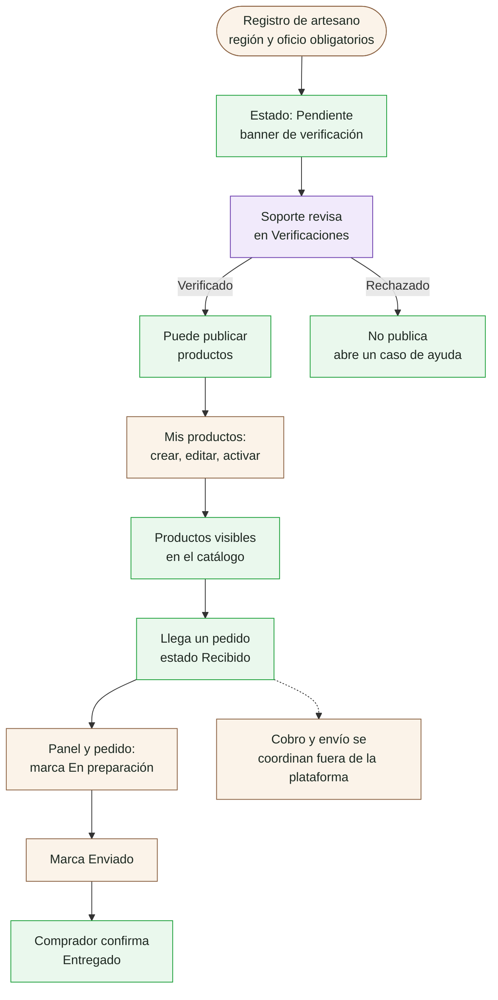
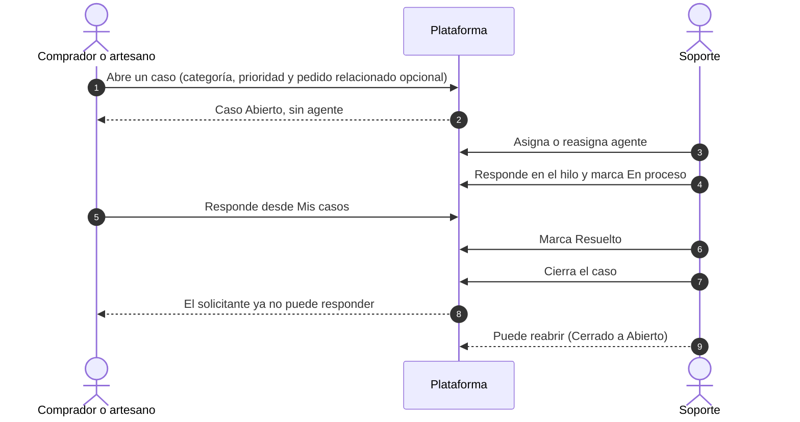
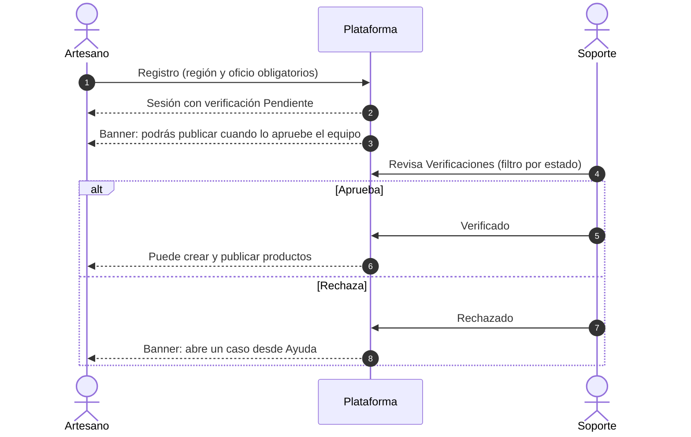
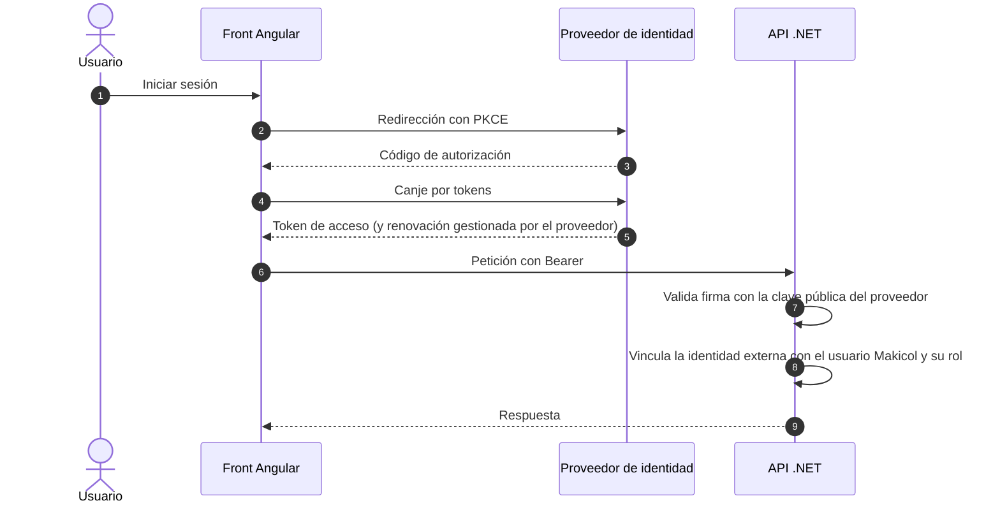

# Análisis para el plan de negocio de Makicol

> Documento de trabajo. Reúne el análisis que sustenta el plan de negocio de la propuesta:
> pagos y envíos, autenticación, estructura del plan y flujos por rol construidos desde el demo.
> El plan de trabajo completo está en la conversación de planificación; aquí se registra lo ya
> levantado y verificado. **Estado: Fase 0 completada; Fase 1 en curso (A1 y F2 a F5 en borrador, pendientes de contraste con el demo).**

**Equipo:** Jorge Luis Arévalo Murcia (estudiante de Análisis y Desarrollo de Software del SENA,
desarrollador full stack semi senior con más de 5 años de experiencia; desarrollo) y Rafael José
Granados Avendaño (tecnólogo en Guianza Turística egresado del SENA; producto, turismo y artesanos).

**Principio:** el demo es la evidencia de lo que existe hoy; la propuesta explica el plan para
producción. Cuando difieren, se dice de forma explícita ("en el demo es así; en producción será así").

## Índice

| Parte | Contenido | Estado |
|---|---|---|
| 1 | Pagos y envíos (O1 a O8) | pendiente |
| 2 | Autenticación y migración a un proveedor externo (A1 a A7) | **A1 en borrador** (§2) |
| 3 | Plan de negocio y depuración de la propuesta (B1 a B7) | **Inventario en primera pasada** (§3); sin cambios en la propuesta |
| 4 | Flujos por rol desde el demo (F1 a F7) | **F1 a F7 en borrador** (§0 y §4); falta contrastar pantallas y revisión visual |

## 0. Convenciones de los diagramas

- **Herramientas:** Mermaid para flujos y estados sencillos (se muestran directo en este documento);
  PlantUML (`plantuml.jar` + Graphviz, ya instalados) para secuencias y calles por rol, exportadas a SVG.
  Fuentes y SVG en `docs/diagramas/`.
- **Colores por rol:** comprador azul, artesano ocre, soporte violeta, auditor gris, sistema verde.
- **Estado de cada paso:** sólido = existe en el demo y está verificado; punteado = declarado pero
  no demostrado en ejecución (solo código, specs o pruebas); etiqueta **[prod]** = cambia en producción.
- **Tamaño:** máximo 12 a 15 nodos por diagrama; los largos se dividen.
- **Procedencia:** cada diagrama cita el código o la spec de donde sale. Nada se infiere sin fuente.
- **Demo en ejecución:** acceso de solo lectura con las cuentas demo. No se crean pedidos, casos ni
  usuarios en la API desplegada sin autorización expresa.

## 2. Autenticación (Parte 2)

### A1. Cómo funciona hoy la autenticación del demo

Diagrama: [`diagramas/a1-autenticacion-demo.puml`](diagramas/a1-autenticacion-demo.puml)
(SVG: [`diagramas/a1-autenticacion-demo.svg`](diagramas/a1-autenticacion-demo.svg)).

**Cómo funciona**

- **Emisión:** la API firma un JWT con clave simétrica (`HmacSha256`, `JwtSettings:Key`) con los
  claims id, correo, nombre y rol; dura **30 minutos**. El refresh token es aleatorio (48 bytes) y dura
  **7 días** (`AuthService.cs`, `AuthCommands.cs`).
- **Contraseñas:** BCrypt, mínimo 8 caracteres (`RegisterValidator`).
- **Registro público:** solo `buyer` y `artisan`; el artesano nace con verificación "Pendiente".
- **Renovación:** el refresh rota (revoca el usado y emite otro). Una sola renovación en vuelo,
  compartida entre peticiones (`AuthStore.refresh`, regla AUTH-001).
- **Sesión en el front:** `localStorage` clave `makicol.session` (regla AUTH-002).
- **Rutas:** `guestOnlyGuard`, `roleGuard`, `storefrontGuard` y `returnUrl` seguro (NAV-001 a NAV-007).
- **Protecciones existentes:** límite de intentos por IP en login y refresh (`auth-login`), registro de
  actividad de `login` y `login_failed`, validación de emisor, audiencia y vigencia del token.
- **Puerto de autenticación:** `AuthStore` depende de la interfaz `Authable` (`AUTH_REPOSITORY`) con
  `login`, `register`, `refresh` y `logout`; es la costura por donde entraría otro proveedor.

**Puntos débiles para producción (verificados en el código)**

| Punto | Hallazgo | Fuente |
|---|---|---|
| Token en `localStorage` | Cualquier script que corra en la página puede leerlo (riesgo XSS) | `auth.store.ts`, AUTH-002 |
| Clave de firma simétrica | La misma clave firma y valida; quien la tenga puede emitir tokens | `AuthService.cs`, `Program.cs` |
| Refresh token en claro en la BD | Se guarda el valor tal cual, no su hash | `AuthCommands.cs` |
| Sin detección de reutilización | Un refresh revocado solo devuelve 401; no revoca la cadena | `RefreshHandler` |
| Sin verificación de correo | El registro devuelve sesión sin confirmar el correo | `RegisterHandler` |
| Sin recuperación de contraseña | No encontré endpoint ni comando en el backend | búsqueda en `Makicol.*` |
| Sin MFA | No encontré soporte | búsqueda en `Makicol.*` |
| Sin bloqueo de cuenta | Solo hay límite por IP; no hay bloqueo por usuario | `LoginHandler` |
| Cuentas de backoffice | Soporte y auditor no se registran por la API pública; en el demo existen por el seed | `RegisterValidator`, `DemoDataSeeder.cs` |

> "No encontré" significa que no apareció en las búsquedas hechas el 26-oct-2026; se confirma al
> revisar el controlador completo antes de usarlo como afirmación en el plan de negocio.

**Contradicción con la propuesta (A2, adelanto):** el contrato de API de la propuesta dice
"autenticación propia" con JWT propio, y su diagrama de arquitectura muestra Azure AD B2C. Auth0 no
aparece en el sitio de la propuesta.

## 4. Flujos por rol (Parte 4)

### F2. Flujo del comprador (demo hoy)

Fuentes: `specs/frontend/routes-and-flows.md` (NAV-001 a NAV-007, CHK-001 a CHK-005),
`specs/features/002-revalidar-carrito` (CART-001 a CART-007), `libs/roles/buyer/*`,
`StatusSeeder.cs` (transiciones de pedido). Líneas punteadas = no demostrado en ejecución todavía.

**Qué muestra y por qué (ficha F7, borrador)**

- **Navegación pública:** el comprador explora sin cuenta (NAV-005); la sesión se pide solo al comprar.
  Reduce la fricción de entrada.
- **Revalidación del carrito:** precio y stock pueden cambiar mientras el comprador decide; el carrito
  se concilia y avisa en cada cambio (CART-003 a CART-005, CART-007). Protege de pagar un precio viejo.
- **Un pedido por artesano:** el comprador envía el carrito completo y el backend lo divide; cada
  artesano gestiona solo lo suyo.
- **El comprador cierra el ciclo:** la entrega la confirma él (transición Enviado → Entregado permitida
  al comprador), lo que habilita las reseñas.

**Lo que hoy NO hace el demo (se marca para la Parte 1 y el plan de negocio)**

- **No hay cobro:** el método de pago es una preferencia informativa, sin pasarela.
- **El método de pago no depende del artesano:** la lista es global y se envía un único valor para
  todo el carrito aunque haya varios artesanos (CHK-001).
- **Dirección y notas del checkout no se envían** (CHK-004, pendiente BR-7).
- **Tras recargar** la confirmación solo se encuentra entre los primeros 20 pedidos (CHK-005, BR-8).
- **Por verificar contra el demo:** pantalla de reseñas (aparece en el seed y en las reglas del
  backend; falta confirmar el flujo en el front) y los textos exactos del paso de pago.

### F3. Flujo del artesano (demo hoy)

Fuentes: `libs/roles/artisan/*` (rutas `panel`, `pedidos/:id`, `mis-productos`, `ayuda`, `mis-casos`),
`verification-banner.component.ts`, `artisan-order-detail-page.component.ts`, `StatusSeeder.cs`,
`RegisterHandler` (el artesano nace "Pendiente").

**Qué muestra y por qué (ficha F7, borrador)**

- **Verificación antes de vender:** no publica hasta que soporte lo apruebe; protege a los compradores y
  la reputación del catálogo. El banner decide el texto por `isTerminal` y `allowsPublishing`.
- **El artesano mueve el pedido, no cierra la venta:** avanza Recibido a En preparación y a Enviado; la
  entrega la confirma el comprador.
- **El demo lo dice con todas las letras:** la pantalla del pedido muestra "Preferencia de pago del
  comprador (…): el cobro se coordina fuera de la plataforma". Es el punto de partida de la Parte 1.
- **El panel** muestra pedidos en curso, entregados, ingresos y productos activos.

**A verificar:** el comentario del seed dice que la verificación "hoy es automática", pero el front tiene
una pantalla manual de soporte (filtro por defecto en Pendiente). El diagrama muestra la revisión manual,
que es lo que implementa el front.

### F4. Flujo de soporte (asesor) (demo hoy)

Fuentes: `libs/roles/support/*` (rutas `panel`, `casos`, `casos/:id`, `verificaciones`, `historias`),
`case-detail-page`, `artisan-verifications-page`, `StatusSeeder.cs` (transiciones de casos).

**Qué muestra y por qué (ficha F7, borrador)**

- **Un solo punto de ayuda** para compradores y artesanos, con prioridad, categoría y pedido relacionado.
- **Estados con roles:** solo soporte mueve el caso (Abierto, En proceso, Resuelto, Cerrado) y puede
  reabrir uno cerrado; las transiciones vienen del catálogo del backend.
- **Soporte también cuida el catálogo:** verifica artesanos y publica las historias del sitio.
- **Pendiente para el plan:** en la Parte 1 soporte pasaría a gestionar guías y estados de envío (simulado).

**Limitación conocida del backend:** se puede escribir en casos cerrados y la prioridad es texto libre
(BR-4); el front lo mitiga deshabilitando el envío en casos terminales.

### F5. Flujo del auditor (demo hoy)

Fuentes: `libs/roles/auditor/*` (rutas `resumen`, `ventas`, `artesanos`, `compradores`, `soporte`),
`summary-page.component.ts`, `routes-and-flows.md`.

**Qué muestra y por qué (ficha F7, borrador)**

- **Evidencia sin poder de cambio:** el auditor consulta, no modifica; da transparencia a aliados e
  inversionistas sobre ventas, artesanos, compradores y soporte.
- **El resumen** compara con el mes anterior (GMV, pedidos y casos) y acumula 12 meses.
- **Pendiente para el plan:** la comisión del 6% y la liberación de pagos (Parte 1) aparecerían aquí en
  producción; hoy el demo no calcula comisión.

### F6. Flujos transversales (de extremo a extremo)

Convención: **demo hoy** = verificado en código, specs o datos del demo; **PROPUESTO** = aún no existe.

#### F6a. Compra completa (demo hoy)

Fuente PlantUML: [`diagramas/f6a-compra-completa-demo.puml`](diagramas/f6a-compra-completa-demo.puml)

Lo que no sale en el diagrama pero conviene saber: el stock se valida y descuenta **sin transacción ni control
de concurrencia** (BR-1 del front), por lo que una sobreventa es posible; el carrito mitiga parte del riesgo
al revalidar precio y stock. Las reseñas se asocian a productos de pedidos entregados (regla del backend
según el seed).

#### F6b. Incidencia: del caso al cierre (demo hoy)

Fuentes: `StatusSeeder.cs` (transiciones de casos), `case-detail-page` de soporte, rutas `ayuda` y `mis-casos`
de comprador y artesano.

Nota: el backend permite escribir en casos cerrados y la prioridad es texto libre (BR-4); el front deshabilita
el envío en estados terminales.

#### F6c. Alta y verificación de un artesano (demo hoy)

Fuentes: `RegisterHandler`, `verification-banner`, `artisan-verifications-page`, datos del seed (Luis Castillo
sigue Pendiente).

Nota: el backend solo aplica el bloqueo de publicación al **crear** productos, no al editar, reactivar ni
comprar (BR-3).

#### F6d. Identidad y sesión

- **Demo hoy:** ver A1 (JWT propio de 30 minutos con refresh de 7 días).
- **PROPUESTO para producción:** proveedor externo (Auth0 u otro, ver Parte 2). El diseño detallado queda para A4 a A6.

#### F6e. Pago y envío según el modelo del artesano (PROPUESTO)

Fuente PlantUML: [`diagramas/f6e-pago-y-envio-modelos.puml`](diagramas/f6e-pago-y-envio-modelos.puml)

Es el diseño de trabajo de la Parte 1; **ningún paso está integrado hoy**. El modelo A depende del concepto
legal sobre retener fondos de terceros y de contratar la API de la transportadora (ver 3.6).

### F7. El "por qué" de cada flujo (resumen)

| Flujo | Problema que resuelve | Decisión de producto que lo explica | Qué se simplificó en el demo |
|---|---|---|---|
| Comprador (F2) | Comprar artesanías sin fricción de entrada | Explorar sin cuenta; sesión solo al comprar; carrito que se revalida | No hay cobro ni envío integrados; dirección y notas no se envían (CHK-004) |
| Artesano (F3) | Vender con confianza para el comprador | Verificación por soporte antes de publicar | El estado de envío es manual; el cobro se coordina fuera |
| Soporte (F4) | Un solo punto de ayuda y de control del catálogo | Estados con roles; verificación e historias a cargo de soporte | Prioridad como texto libre; casos cerrados admiten escritura en el backend |
| Auditor (F5) | Transparencia para aliados e inversionistas | Rol de solo lectura con métricas y trazabilidad | Sin comisión ni liberación de pagos que mostrar |
| Compra completa (F6a) | Que las cuatro partes vean lo mismo del pedido | Un pedido por artesano; el comprador cierra el ciclo | Sin transacción de stock (BR-1) |
| Incidencia (F6b) | Resolver problemas con trazabilidad | Hilo único por caso, con pedido relacionado | Sin prioridades cerradas ni SLA |
| Alta de artesano (F6c) | Proteger la reputación del catálogo | Aprobación manual de soporte | Bloqueo solo al crear productos (BR-3) |
| Identidad (F6d) | Seguridad real en producción | Proveedor de identidad externo y estandarizado | JWT propio y sesión en `localStorage` |
| Pago y envío (F6e) | Confianza en el cobro y seguimiento del envío | El artesano elige directo o por la plataforma | Todo propuesto, nada integrado |

## Acceso al demo en ejecución

**Causa del fallo inicial (26-oct-2026):** el DNS configurado en el equipo (el router, `192.168.40.1`)
rechaza el nombre de la API (`RCODE_REFUSED`); los DNS públicos (`8.8.8.8`, `1.1.1.1`) sí lo resuelven a
`20.118.48.17`. No es un problema de CORS ni de la API. El navegador funciona probablemente por DNS
seguro propio. Se sorteó sin cambiar la configuración del sistema, forzando la resolución con
`curl.exe --resolve`.

**Contraste hecho (solo lectura; login de la cuenta del comprador principal, sin crear nada):**

| Dato | Seed (`DemoDataSeeder.cs`) | Demo desplegado |
|---|---|---|
| Productos públicos | 8, con los nombres actuales del seed | **8, coinciden** (p. ej. "Sombrero vueltiao 21 vueltas" de Carmen Vidal) |
| Pedidos de la compradora principal | 6 | 6: Entregado 3, Enviado 1, Recibido 1, **Cancelado 1** |
| Casos de la compradora principal | 4, uno por estado | **4, uno por estado** (Abierto, En proceso, Resuelto, Cerrado) |

- **Cancelado:** el seed no crea pedidos Cancelados y el demo tiene uno de la compradora principal.
  Alguien canceló un pedido: **los datos publicados ya no son idénticos al seed**. Es evidencia en
  ejecución de que el comprador puede cancelar un pedido Recibido (F2).
- **Artesanos:** los productos confirman la versión actual del seed (Carmen Vidal con sombrero vueltiao)
  y no la antigua (barniz de Pasto); el perfil de Luis (Mompox, filigrana) lo confirma la segunda ronda.
- La llamada incluyó un login (queda un refresh token y una entrada `login` en el registro de
  actividad); no se creó ni se cambió ningún dato.

**Contraste por rol (segunda ronda, solo lectura, un login por cuenta):**

| Rol | Dato observado en el demo | Lectura |
|---|---|---|
| Artesano Luis Castillo | Verificación **Pendiente**, Mompox, filigrana de plata, pago `nequi` | Coincide con el seed actual; la verificación no se aprobó sola |
| Artesana Rosa Noriega | Verificada, Riohacha, tejido wayuu, pago `nequi`; 3 pedidos: Entregado 2, En preparación 1 | Coincide; el panel del artesano muestra sus pedidos |
| Soporte Sofía Ramírez | 4 casos: Abierto, En proceso, Resuelto, Cerrado; **los 4 son de compradores**, ninguno de artesanos | Coincide con el seed |
| Auditor Aurora Benítez | Métricas con datos solo en sep-2026 (GMV 320.000, 4 entregados) y oct-2026 (GMV 200.000, 2 entregados, 4 casos); los demás meses en cero | El resumen y las gráficas tienen datos reales del demo |

- **Verificación de artesanos (F3):** Luis sigue Pendiente en el demo, lo que apoya la revisión manual
  por soporte. Falta ver el alta de un artesano nuevo para descartar una aprobación automática.
- **Datos de pago:** todos los artesanos y pedidos consultados usan `nequi`: el demo no permite probar
  hoy la elección de medios por artesano (Parte 1).
- **Sin contrastar todavía:** flujo de reseñas en pantalla y el listado de verificaciones del soporte:
  la consulta del endpoint con `statusId` devolvió los 4 artesanos tanto para Pendiente como para
  Verificado, así que ese parámetro no filtró (el front puede usar otro nombre; sin confirmar).
- **Existe en la API (swagger):** `POST /products/{id}/reviews` (reseñas) y
  `PATCH /artisans/{userId}/verification` (verificación). **No existen** endpoints de pagos, de comisiones
  ni para crear o actualizar envíos internacionales; solo el catálogo de estados. Es la brecha de la Parte 1.
- **Límite de intentos medido:** ocho inicios de sesión en pocos segundos activaron el límite
  (`auth-login`, mensaje "Demasiados intentos"); tras esperar cerca de un minuto volvió a responder.
  Es un dato real para A1. Los inicios de sesión del contraste quedan en el registro de actividad del
  demo (visibles para el auditor), junto con los de las cuentas usadas.

**Aún por contrastar:** flujo de reseñas, alta de un artesano nuevo y las pantallas (no solo los datos).

## 3. Inventario de la propuesta (Parte 3)

Alcance: lectura de `hero`, `financial` (tabla y simulador), `international-shipping`,
`architecture/scalability-phases`, `backoffice-evaluation` y `technical` (por grep). Sin leer en detalle:
`database-design`, el navbar y los assets. **No se ha modificado ni borrado nada de la propuesta.**

### 3.1 Estructura actual del sitio

| Ruta | Contenido | Vigencia frente al demo |
|---|---|---|
| `/` | Selector de rol del **prototipo** (`marketplace/`) | Desactualizado; el demo real lo reemplaza |
| `/marketplace/*` | Prototipo navegable (51 archivos, datos simulados) | Desactualizado; candidato a retirar tras rescatar texto |
| `/propuesta` | Navbar, hero, financiero, técnico, arquitectura | Es el núcleo del plan de negocio, con cifras por corregir |
| `/envios-internacionales` | Investigación regulatoria y tarifas | Valiosa; parte de las cifras es incorrecta o sin fecha |
| `/evaluacion-backoffice` | Storefront frente a back-office | Desactualizada (ver 3.5) |
| `/base-de-datos` | ER v6 y tablas `Mk*` | Por contrastar con las entidades reales del backend |
| `/contrato-api` | Contrato `/api/makicol/*` | **Desactualizado**: el demo usa `/api/*` (sin prefijo `makicol`) |

### 3.2 Auditoría de cifras y afirmaciones

Estado: **V** verificada, **A** a actualizar, **S** sin sustento, **N** no aplica hoy (visión), **?** sin verificar.
Las filas con fuente externa se sustentan en 3.6.

| # | Afirmación (dónde) | Estado | Observación |
|---|---|---|---|
| 1 | "500+ productores registrados en Makicol" (hero, Fase 1) | **S** | El demo tiene 4 artesanos de prueba. Sin evidencia de 500 productores ni de su relación con Makicol |
| 2 | "50.000 visitantes proyectados al año" (hero) | **S** | Sin fuente ni metodología |
| 3 | Comisión "5-8 %" (financiero) frente a "6 %" (FAQ del prototipo, panel del auditor) | **A** | Dos cifras para lo mismo; elegir una (el demo no calcula comisión) |
| 4 | 200 productores x USD 50/mes x 6 % = ~USD 600/mes | **A** | La cuenta es correcta, pero ignora el costo de la pasarela: el neto sería ~USD 232 (ver 3.6) |
| 5 | "Se autofinancia desde el mes 8" y "sostenible desde el primer año" | **S** | No hay curva de crecimiento que lo respalde |
| 6 | Patrocinadores (Ministerio de Cultura, Banco de la República) cubren ~USD 1.800 el año 1 | **S** | Sin acuerdo ni carta; presentarlo como objetivo, no como hecho |
| 7 | Costo Fase 1 "USD 131-180/mes" (fases) | **A** | Es el total de la tabla solo con 50 productores (131). Con 200 productores la misma tabla da **260** |
| 8 | Tabla de costos frente a simulador | **A** | Dos modelos distintos (productores frente a usuarios activos) con precios diferentes: 300 usuarios = USD 126 en el simulador y 200 productores = USD 260 en la tabla. Unificar |
| 9 | "Azure Media Services" (tabla, fases, simulador) | **A** (verificado) | Retirado el **30-jun-2024**. Reemplazar o sacar los reels del alcance |
| 10 | "Azure CDN (Akamai)" (tabla) | **A** (verificado) | Retirado el **31-oct-2023**; además "CDN Standard from Microsoft (classic)" se retira el **30-sep-2027** |
| 11 | Front Door Standard "USD 22" con WAF | **A** (verificado) | La base publicada es **USD 35/mes**; el WAF administrado exige Premium (USD 330) |
| 12 | "API marketplace + Angular SSR PWA" en App Service | **A** | El front del demo es un SPA en Azure Static Web Apps y el SSR se revirtió (historial de git); la PWA no se ha verificado |
| 13 | Pagos con Wompi (PSE, Nequi, Daviplata, tarjeta, Efecty) en Fase 1, "Ago-Nov 2026 (lanzamiento MVP)" | **A** | Hoy es octubre de 2026 y el demo **no cobra**. Los medios coinciden con los de Wompi, pero cambiar el estado a "en diseño" y la fecha a una propia |
| 14 | "Reels de 30 s" (Fase 2, hero) | **N** | No existe ni está en construcción; mover a visión |
| 15 | Fase 3: IA, app Android, Etsy y Amazon Handmade, Cosmos DB, OpenAI | **N** | Sin sustento a corto plazo; condensar |
| 16 | "Azure AD B2C" (arquitectura) frente a "autenticación propia" (contrato) | **A** (verificado) | B2C no se vende a clientes nuevos desde el **1-may-2025**; Microsoft recomienda Entra External ID |
| 17 | Fin del "de minimis" de EE. UU. el 29-ago-2025; recargo ~15 % | **V** (fecha) / **?** (recargo) | Fecha confirmada por CBP. Por el correo postal no se exige entrada de CBP: el operador paga según la tasa IEEPA. El recargo del 15 % no apareció en fuentes oficiales |
| 18 | Certificado de Origen TLC: DIAN gratis, Cámara de Comercio COP 25.000-80.000, VUCE, vigencia de 4 años | **A** (verificado en lo esencial) | Para el acuerdo con EE. UU. la DIAN indica **autocertificación** (la emite productor, exportador o importador, sin la DIAN y sin formulario obligatorio). La ruta de Cámara de Comercio y su costo no se sustentan; la vigencia de 4 años no se confirmó |
| 19 | Tarifas de FedEx, DHL y 4-72 (COP y USD) | **?** | Cotizaciones de fecha desconocida; requieren cotización vigente |
| 20 | Evaluación de catálogo para el piloto (8 productos) | **A** | Mezcla nombres del demo con otros que ya no están (Hamaca San Jacinto, Cerámica Ritual Tayrona). Alinear con el catálogo actual del seed |
| 21 | "20 días hábiles de entrega" y "3-7 días de tránsito" | **?** | Dependen de las tarifas anteriores |
| 22 | Equipo y experiencia (no figuran en el sitio) | **A** | Falta la sección de equipo (B2c) |

Coincidencia útil: el "Collar de semillas Wayúu" figura como riesgo **alto** (APHIS) y excluido del piloto, y
también está publicado en el catálogo del demo; sirve de ejemplo en el plan de negocio.

### 3.3 Prototipo `src/app/marketplace/`: qué rescatar antes de retirar

| Contenido | Dónde vive | Destino propuesto |
|---|---|---|
| Comisión del 6 % y su redacción de "solo por venta completada" | `data/marketplace-data.ts`, registro del artesano | Modelo de ingresos del plan (decidir con la Parte 1) |
| Liberación del pago 3-5 días tras confirmar la entrega | FAQ del artesano | Flujo de pago del modelo coordinado (Parte 1) |
| Flujo de registro del artesano con método de cobro | `artesano/pages/registro` | Ficha F3 (artesano) |
| Términos del marketplace | `comprador/pages/terminos` | Revisar contra `specs/pendientes.md` del front (texto legal pendiente de decisión) |
| FAQ y datos simulados de pedidos y ventas | `data/` | Retirar; el demo tiene datos de prueba reales |
| Botones y enlaces a `/marketplace` | `hero`, `international-shipping`, `shared` | Reemplazar por el enlace al demo desplegado |

### 3.4 Decisiones propuestas por pieza (sin ejecutar)

| Pieza | Decisión propuesta | Motivo |
|---|---|---|
| `marketplace/` | **Retirar** tras rescatar 3.3 y con tu autorización | El demo real lo sustituye |
| `hero` | **Actualizar** | Cifras sin sustento, botón al prototipo, promesa de pagos y reels |
| `financial` (tabla y simulador) | **Actualizar y unificar** | Dos modelos, servicios retirados, ingreso que ignora la pasarela |
| `technical` | **Actualizar** | Angular 21 frente a 22 y PWA sin verificar |
| `architecture` (diagrama y fases) | **Actualizar** | Mostrar demo hoy y producción prevista (B5); retirar B2C, Media Services y CDN Akamai |
| `international-shipping` | **Conservar y corregir** | De lo más sólido, pero con certificado de origen y recargos por corregir y tarifas por fechar |
| `backoffice-evaluation` | **Resumir** | Desactualizada (ver 3.5) |
| `database-design` y ER v1-v5 | **Actualizar a la v6 vigente** y mover las anteriores a histórico | Son 6 iteraciones; solo la última es útil |
| `contrato-api` | **Actualizar** | Prefijo y autenticación distintos del demo |
| `docs/valoracion-trabajo-realizado.md` y su prompt | **Actualizar** (equipo, métricas y tarifas) | Ver B5b |
| `public/assets` | **Retirar con el prototipo** lo que solo él usa; **eliminar** lo que nadie usa (ver 3.7) | Imágenes de 0,3 a 1 MB c/u |
| `.angular`, `.nx`, `dist`, `node_modules` | **Conservar como está** | `.gitignore` ya los excluye y ninguno está versionado |

### 3.5 Lectura de `backoffice-evaluation` y `technical`

- **`backoffice-evaluation`:** recomienda separar el frontend en storefront y back-office, "mientras el equipo
  es pequeño" mantener el monolito. Está **desactualizado**: afirma que la autenticación "aún no está
  implementada" y habla de "un solo proyecto Angular"; hoy el front es un monorepo Nx con 43 proyectos,
  límites por capa y por rol aplicados por lint, y fragmentos de carga diferida por rol. Decisión: **resumir
  en una sola sección** ("el demo ya separa por rol; separar aplicaciones queda como opción futura").
- **`technical` (PWA frente a nativo):** menciona "Angular 21" (el front usa Angular 22), "Wompi Web SDK",
  "Web Payments API + 3DS" y PWA instalable. **Sin verificar**: la PWA no aparece como funcionalidad del demo.
  Decisión provisional: conservar la comparación y actualizarla a lo que realmente existe.

### 3.6 Verificación externa (primera ronda, consultada el 26-oct-2026)

Fuentes citadas: Microsoft Learn (retiro de Azure Media Services; preguntas frecuentes de Azure AD B2C y de
Entra External ID; retiro de Azure CDN Akamai; precios de Front Door), CBP (CSMS 66065494) y Federal Register
(orden ejecutiva 14324), DIAN (Abecé de pruebas de origen), Wompi (planes y tarifas, documentación de
pagos a terceros y centro de ayuda), Auth0 (página de precios), Servientrega (documentación de su API) y
la normativa de sistemas de pago de bajo valor (Decreto 1692 de 2020).

**Pagos (Parte 1):**

| Dato | Resultado | Fuente |
|---|---|---|
| Tarifa de Wompi (plan Agregador) | **2,65 % + COP 700 + IVA** por transacción exitosa; el dinero llega al día hábil siguiente | wompi.com, planes y tarifas |
| Tarifas en enlaces de pago de Nequi Negocios | Nequi o Bancolombia 1,5 %; tarjetas 1,99 %; PSE 2,69 % (más IVA). En tarjetas, retención en la fuente de 1,5 % para el comercio | Nequi, centro de ayuda |
| Medios de pago de Wompi | Tarjetas (incluidas internacionales), PSE, Botón Bancolombia, Nequi, Daviplata, QR y efectivo | wompi.com |
| División de pagos entre vendedores ("split") | El centro de ayuda de Wompi (artículo de 2020) dice que **no maneja split**: desembolsa al comercio registrado. Existe una **API de pagos a terceros** (dispersión a cuentas bancarias, por lotes, con webhook y llaves BRE-B) | Wompi, soporte y documentación |
| Regulación | Decreto 1692 de 2020 distingue adquirente y agregador dentro de los sistemas de pago de bajo valor. El Banco de la República advierte que retener dinero de terceros puede tipificar actividades reguladas. **Para el modelo de recaudo y liberación hace falta concepto legal** | Decreto 1692; Banco de la República, concepto Q16-1712 |

**Lectura para el modelo de cobro (borrador, sin asesoría legal):**

- El **Modelo B** (el pago es directo y la plataforma registra y concilia) no toca dinero de terceros: es el
  de menor riesgo regulatorio.
- El **Modelo A** (recaudo y liberación tras la entrega) es técnicamente posible con Wompi (cobro más API de
  pagos a terceros), pero la plataforma recibiría y retendría fondos de otros, lo que exige confirmar con un
  abogado si basta contratar a un agregador o si la plataforma debe constituirse en uno.

**Economía de la comisión (cálculo propio con los supuestos de la propuesta):**

| Concepto | Valor |
|---|---|
| Venta promedio | USD 50 = COP 158.734 (TRM 3.174,67 del documento de valoración del 19-oct-2026, sin verificar) |
| Comisión de la plataforma (6 %) | COP 9.524 |
| Costo de Wompi (2,65 % + 700 + IVA) | COP 5.839, es decir **3,68 % de la venta** |
| **Margen neto por venta** | **COP 3.685, es decir 2,32 % de la venta** |
| 200 productores x una venta de USD 50 al mes | Comisión USD 600; costo de Wompi USD 368; **neto USD 232/mes**, frente a una infraestructura de USD 260 que da la propia tabla para 200 productores |

Conclusión: **el "ingreso de ~USD 600/mes que supera el costo operativo" no se sostiene** si la plataforma
cobra por pasarela, porque el costo de la pasarela se come cerca de 60 % de la comisión del 6 %. El
modelo de ingresos necesita revisarse (comisión, fijo por pedido, plan por artesano o menor costo de
infraestructura).

**Identidad (Parte 2):**

| Dato | Resultado | Fuente |
|---|---|---|
| Azure AD B2C | No se vende a clientes nuevos desde el 1-may-2025; P2 se descontinúa el 15-mar-2026; soporte al menos hasta mayo de 2030 | Microsoft Learn |
| Microsoft Entra External ID | Es el producto recomendado para aplicaciones nuevas (no es un cambio de nombre de B2C) | Microsoft Learn |
| Auth0, plan gratuito | Hasta **25.000 usuarios activos al mes**, redes sociales ilimitadas, sin contraseña, un dominio propio y protección básica | auth0.com/pricing |
| Auth0, planes de pago (B2C) | Essentials desde USD 35/mes (500 usuarios; 1.000 = USD 70; 5.000 = USD 350); Professional desde USD 240/mes | auth0.com/pricing |
| Migrar usuarios existentes con su contraseña | Las "conexiones de base de datos personalizadas" aparecen en el plan Professional según un análisis de terceros; **sin confirmar con Auth0** | itsecureops.com (fuente secundaria) |

Lectura: el plan gratuito de Auth0 cubre con holgura el tamaño previsto (cientos de productores y compradores
al inicio); el cambio a un plan de pago ocurriría por funciones (MFA, soporte), no por volumen. Falta
comparar el costo de Entra External ID y confirmar cómo migrar los hashes BCrypt del demo.

**Envíos (Parte 1):**

| Dato | Resultado | Fuente |
|---|---|---|
| API de Servientrega | Existe una **API pública** (Swagger) con webhooks y integración con WooCommerce y Shopify; las credenciales (`clientKey`) las entrega Servientrega | servientregaapi.com |
| Rastreo clásico | Servicio web SOAP `wsRastreoEnvios` (operación `EstadoGuias`) que exige el **ID de cliente** y los números de guía | Servientrega |
| Alternativa de agregador | AfterShip normaliza estados (`Pending`, `InfoReceived`, `InTransit`, `OutForDelivery`, `AttemptFail`, `Delivered`, `AvailableForPickup`, `Exception`, `Expired`) | AfterShip |
| Conclusión | Recibir estados reales exige un **contrato de cliente con la transportadora** o un agregador de pago por uso. Los estados normalizados sirven de base para el mapa de la Parte 1 (O5) | |

**Aun sin verificar:** tarifas de FedEx, DHL y 4-72 (cambian a diario y requieren cotización), el recargo
del ~15 % de los operadores, la vigencia del certificado de origen, el precio de Entra External ID, la
migración de usuarios a Auth0, la TRM actual, tarifas de transportadoras nacionales y cualquier cifra de
mercado o de patrocinadores.

### 3.7 `database-design`, `contrato-api`, assets y artefactos

**`database-design` (ER v6) frente a lo que existe en el backend:**

| Tema | El ER v6 dice | El demo hace |
|---|---|---|
| Verificación del artesano | "Hoy la verificación es automática (24 h post-registro)" | Pantalla manual de soporte y un artesano que sigue Pendiente (F3). Este texto es el origen de la duda y debe corregirse |
| Pedidos | "Un pedido puede incluir productos de varios artesanos" | **Un pedido por artesano**; el backend divide el carrito |
| Estados de pedido | Recibido, En preparación, Enviado, Entregado | Existe también **Cancelado** (el comprador puede cancelar en Recibido) |
| Pedido | Sin pago ni agrupación | Tiene `paymentMethodPreference` informativo y `checkoutGroupId` |
| Producto | Sin stock, región ni imágenes | Tiene stock, región e imágenes (`ProductImage`) |
| Artesano | Sin ciudad, año de inicio, materiales, avatar ni portada | Los tiene (perfil público) |
| Contenido editorial | No aparece | Existen las **historias** (editor de soporte) |
| Envío internacional | Entidad completa con estados | Solo existe el catálogo de estados; no hay endpoints para crearlo (ver 3.6) |

Decisión propuesta: **regenerar el ER (v7) desde las entidades reales** del backend, con una capa "demo hoy"
y otra "producción prevista" (pagos, comisión, medios de pago por artesano, envío). Es el diagrama que más
se beneficia de pasar a PlantUML o Mermaid (ya existe `er-diagram.puml`).

**`contrato-api` (`/api/makicol/*`):**

- Se presenta como un servicio que **"feria-artesanal-api" expondrá** bajo el prefijo `/api/makicol`. El demo
  usa un servicio propio (`makicol-api`) con rutas `/api/...` sin ese prefijo.
- El Swagger del demo ya publica el contrato real (`/swagger/v1/swagger.json`). Propuesta: **reemplazar la
  tabla manual por una vista generada desde ese Swagger** (o un enlace a él) para que no se desactualice, y
  conservar solo las reglas de diseño (fechas ISO, estados como `{ id, name }`, paginación) que sí coinciden.

**Assets (`public/assets`, 32 archivos):**

| Grupo | Uso | Decisión propuesta |
|---|---|---|
| `foto1` a `foto8.webp`, `D_NQ_...webp`, `hero_banner_1.jpg`, `artesana-*`/`artesano-*` (avatar y portada), `makicol-logo-header.svg` | Solo el prototipo `marketplace/` | Retirar con el prototipo (las fotos reales ya están en el demo) |
| `logo-corazon.png` (1 MB), `makicol-logo-header1.svg` | **Ninguna referencia** | Eliminar |
| `makicol-icono-base.svg`, `fonts/` | Secciones de la propuesta | Conservar |
| `makicol-er-diagram-v1` a `v6.svg` | Dos referencias en el sitio | Dejar solo la v6 (y la v7 cuando exista); las demás a un histórico fuera del sitio |
| `fondo-arena.png`, `decoracion-esquina.png`, `artesanias.png` | **El `hero` las usa pero no existen** en `public/assets` | Corregir: imágenes rotas hoy en la portada |

Hallazgo: la portada de la propuesta carga tres imágenes que no están en el repositorio; el sitio desplegado
muestra esos espacios vacíos (sin verificar visualmente).

**Artefactos del repo:** `.gitignore` excluye `/dist`, `/node_modules` y `/.angular/cache`, y `git ls-files` no
muestra ninguno versionado. `.nx` no figura en `.gitignore` pero no hay archivos suyos versionados; conviene
añadirlo.

## Pendientes inmediatos

0. Verificar lo que aún figura como "sin verificar" en 3.6 y revisar el navbar, `technical` en detalle y
   la imagen real de la portada.
1. Contrastar las pantallas del demo (reseñas, alta de artesano, listado de verificaciones) con una
   revisión visual tuya o capturas.
2. Completar A1 con la revisión del controlador completo y los límites de intentos configurados.
3. Flujos de extremo a extremo (F6) y fichas F7 completas.
4. Completar el inventario (B4) con `database-design`, `contrato-api`, el navbar, los assets y los
   artefactos del repo; y comparar con fuente el costo de Entra External ID y de las transportadoras.
